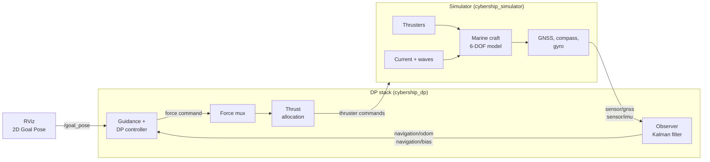

<div align="center">

# Cybership BlueBoat — Dynamic Positioning Simulator

**A ROS 2 simulator and DP control stack for the BlueBoat catamaran *Microampere*,<br>built on Fossen's marine craft models.**


</div>

---

## Contents

1. [What you get](#what-you-get)
2. [Requirements](#requirements)
3. [Quick start](#quick-start)
4. [Everyday use: switch things on and off](#everyday-use-switch-things-on-and-off)
5. [Change the boat](#change-the-boat-vesselyaml)
6. [Tune the controller](#tune-the-controller-controller_positionyaml)
7. [Add your own vessel](#add-your-own-vessel)
8. [How it works](#how-it-works)
9. [Tests and tools](#tests-and-tools)
10. [Repository layout](#repository-layout)
11. [Troubleshooting](#troubleshooting)
12. [Credits and license](#credits-and-license)

## What you get

| | |
|---|---|
| 🚤 **Vessel model** | 6-DOF Fossen model of Microampere: added mass and damping from Capytaine on the hull CAD, restoring forces, CG offset, nonlinear damping |
| 🌊 **Environment** | Ocean current and irregular waves (JONSWAP, short-crested) |
| 📡 **Sensors** | GNSS (standard or RTK) with lever arm and slow drift, compass and gyro, at their real rates |
| 🧭 **Observer** | DP Kalman filter with wave filter and bias estimate (Fossen 13.4.6) |
| 🎯 **Control** | Model-based DP controller, guidance that picks forward, reverse or sideways moves, optional ALOS path following |
| ⚙️ **Thrusters** | Constrained allocation (QP) for two stern thrusters and a bow azimuth, T200 ESC/PWM model |
| 🧩 **Modular** | Every block is a ROS 2 node, every number is in a YAML file. Change the boat without touching code |

## Requirements

| What | Version |
|---|---|
| OS | **Ubuntu 24.04** |
| ROS 2 | **Jazzy** (`ros-jazzy-desktop`) |
| Python | 3.12 (comes with Ubuntu 24.04) |
| Python packages | [`requirements.txt`](requirements.txt), installed in a venv |

Install ROS 2 Jazzy first with the [official guide](https://docs.ros.org/en/jazzy/Installation/Ubuntu-Install-Debs.html), then:

```bash
sudo apt install ros-jazzy-desktop ros-dev-tools python3-venv python3-pip \
                 ros-jazzy-topic-tools ros-jazzy-nav2-msgs ros-jazzy-xacro
```

## Quick start

**1. Clone into a ROS workspace**

```bash
mkdir -p ~/ros_ws/src && cd ~/ros_ws/src
git clone --recursive https://github.com/alihsar1kaya/cybership_blueboat.git
```

**2. Python environment**

```bash
cd ~/ros_ws
python3 -m venv venv --system-site-packages && touch venv/COLCON_IGNORE
source /opt/ros/jazzy/setup.bash && source venv/bin/activate
pip install -r src/cybership_blueboat/requirements.txt
```

**3. Build**

```bash
sudo rosdep init 2>/dev/null; rosdep update
rosdep install --from-paths src -i -y --rosdistro jazzy
colcon build --symlink-install
```

**4. Run**

```bash
source install/setup.bash
ros2 launch cybership_simulator vessel.launch.py vessel:=microampere dp:=true observer:=true gnss:=rtk
```

RViz opens with the boat. Click **2D Goal Pose** in the top bar, then click and drag on the map: the boat drives there and holds the position and heading. 🎉

> **Every new terminal** needs the three `source` lines:
> ```bash
> cd ~/ros_ws && source /opt/ros/jazzy/setup.bash && source venv/bin/activate && source install/setup.bash
> ```

## Everyday use: switch things on and off

There are two kinds of switches:

- **Launch options** (`name:=value` after `ros2 launch ...`) decide what starts. Restart to change them.
- **Parameters** (`ros2 param set ...`) change a running simulation, no restart needed.

### Recipes

| I want to ... | Do this |
|---|---|
| just see the boat, no control | `ros2 launch cybership_simulator vessel.launch.py vessel:=microampere` |
| drive it to goals (DP) | add `dp:=true` |
| use realistic sensors + Kalman filter | add `observer:=true` |
| cm-accurate GNSS (RTK) | add `gnss:=rtk` (default `standard`: ~0.2 m noise and slow drift) |
| start with waves | add `waves:=true wave_hs:=0.1 wave_tp:=2.3 wave_dir:=0` |
| run without RViz (e.g. on a server) | add `use_gui:=false` |
| turn waves on/off while running | `ros2 param set /microampere/sim environment.waves.Hs 0.1` (`0` = off) |
| add an ocean current | `ros2 param set /microampere/sim environment.current.speed 0.15` |
| change the current direction | `ros2 param set /microampere/sim environment.current.direction_deg 90` (flows towards east) |
| switch DP off (zero thrust) | `ros2 service call /microampere/position_controller/change_state std_srvs/srv/SetBool "{data: false}"` |
| switch DP on again | same with `"{data: true}"` |
| send a goal from the terminal | see below |

```bash
# goal x = 5 m north, y = 3 m east, heading 45 deg (orientation is a quaternion: z = sin(45/2), w = cos(45/2))
ros2 topic pub --once /goal_pose geometry_msgs/msg/PoseStamped \
  "{header: {frame_id: world}, pose: {position: {x: 5.0, y: 3.0}, orientation: {z: 0.383, w: 0.924}}}"
```

### All launch options

| Option | Default | Meaning |
|---|---|---|
| `vessel` | `voyager` | which boat: loads `cybership_config/config/<vessel>/vessel.yaml` |
| `dp` | `false` | start the DP stack (guidance, controller, allocation) |
| `observer` | `false` | controller uses the Kalman filter estimate instead of the true state |
| `gnss` | `standard` | `standard` or `rtk` (profiles in `vessel.yaml`) |
| `noisy_odom` | `false` | without observer: give the controller the true state plus noise |
| `waves` | `false` | irregular waves from the start |
| `wave_hs` / `wave_tp` / `wave_dir` | `0.1` / `2.3` / `0` | wave height [m], peak period [s], direction the waves travel towards [deg] |
| `use_gui` | `true` | start RViz |

> **Directions** follow the marine convention (NED): x = north, y = east, headings in degrees from north, 90 = east.

## Change the boat (`vessel.yaml`)

Everything about the boat is in **one file**:
[`cybership_config/config/microampere/vessel.yaml`](cybership_config/config/microampere/vessel.yaml).
The simulator, the controller, the allocation and the observer all read it, so a change is used everywhere.
Every value has a comment with its source. After editing, just restart the launch (no rebuild needed with `--symlink-install`).

| Section | What it is | Typical changes |
|---|---|---|
| `model.mass`, `inertia`, `cg` | rigid body | weigh the boat and put the real mass here |
| `model.hydro` | added mass and wave data from Capytaine (`hydro_capytaine.npz`) | remove it to use the simple `added_mass` list instead |
| `model.damping` | how the water slows the boat | `surge_time_constant`, `max_speed` from trials |
| `sensors` | GNSS, compass, gyro: rate, noise, drift, antenna position | match your real sensors |
| `allocation` | how the force is split on the thrusters | `slack_weights`: which DOF to give up first when thrust runs out |
| `thrusters` | one entry per thruster | move, add, remove, change strength |

### Example: change a thruster

```yaml
thrusters:
  - name: port
    type: fixed                     # fixed or azimuth (rotating)
    frame: stern_port_thruster_link # link in the URDF, for drawing the force in RViz
    position: [-0.55, -0.29, 0.177] # [m] x forward, y starboard, z down, from the boat centre
    direction_deg: 0.0              # 0 = pushes forward
    max_force: 67.0                 # [N]
    reverse_ratio: 0.8              # reverse thrust is 80 % of forward
    time_constant: 0.1              # [s] how fast the thrust builds up
    allocation:
      weight: 1.0                   # higher = used less
```

- **Stronger motors?** Raise `max_force`.
- **Move a thruster?** Change `position`.
- **Remove the bow azimuth?** Delete its entry. The allocation uses whatever thrusters are listed; with only the two stern thrusters the boat can no longer push sideways, so sway is given up.
- **Add a thruster?** Copy an entry and give it a new `name` and `position`. To see it in RViz, also add a link for its `frame` to the URDF in `cybership_description`.

### Example: different sensors

```yaml
sensors:
  gnss:
    rate: 5.0        # [Hz]
    sigma: 0.17      # [m] white noise
    bias_sigma: 0.3  # [m] slow drift of a non-RTK receiver (0 = none)
    lever_arm: [0.0, 0.0, -0.3]   # [m] antenna position on the boat
  compass:
    sigma_deg: 0.5
  gyro:
    sigma_deg_s: 0.1
```

## Tune the controller (`controller_position.yaml`)

[`cybership_config/config/microampere/controller_position.yaml`](cybership_config/config/microampere/controller_position.yaml)

The controller computes its gains from the boat model, so you mostly change *how fast* it should be, not raw gains:

| Setting | What it does | Turn it up | Turn it down |
|---|---|---|---|
| `control.omega_n` | stiffness per DOF [surge, sway, yaw] | holds tighter, more thrust | softer, calmer |
| `control.zeta` | damping | less overshoot | quicker but may overshoot |
| `filter.omega` | how fast the reference moves to a new goal | quicker moves | smoother, slower moves |
| `guidance.forward_speed` | transit speed [m/s] | faster | slower |
| `guidance.turn_then_go` | turn the bow to the goal before driving | | `false`: plain DP, moves diagonally |
| `guidance.approach_radius` | where transit ends and station keeping starts [m] | | |
| `guidance.path_following` | transit as ALOS line following (Fossen 12.5) | | `false` (default): DP transit |

Many of these can also be changed live:

```bash
ros2 param set /microampere/position_controller guidance.forward_speed 0.4
```

## Add your own vessel

1. Copy the config folder: `cp -r cybership_config/config/microampere cybership_config/config/myboat`
2. Edit `myboat/vessel.yaml`: mass, size, damping, thrusters. Without a Capytaine file, delete `model.hydro` and set `added_mass` by hand.
3. Rebuild once so the new folder is installed: `colcon build --symlink-install --packages-select cybership_config`
4. Run it: `ros2 launch cybership_simulator vessel.launch.py vessel:=myboat dp:=true`

No URDF yet? A generic box model and RViz config are used automatically.

## How it works

The stack follows Fossen's guidance, navigation and control (GNC) block diagram. **Each block is its own ROS 2 node**, and they only talk through topics. That is what makes it modular: you can replace one block (for example the simulator with the real boat's drivers, or the controller with your own) as long as the new node uses the same topics.



### The topic contract

All topics are under the vessel name, e.g. `/microampere/...`.

| Topic | Type | From → to |
|---|---|---|
| `sensor/gnss` | `sensor_msgs/NavSatFix` | simulator (or real GNSS) → observer |
| `sensor/imu` | `sensor_msgs/Imu` | simulator (or real IMU) → observer |
| `navigation/odom` | `nav_msgs/Odometry` | observer → controller |
| `navigation/bias` | `geometry_msgs/Vector3Stamped` | observer → controller |
| `control/force/command/position` | `geometry_msgs/Wrench` | controller → force mux |
| `control/force/command/manual` | `geometry_msgs/Wrench` | joystick / your node → force mux |
| `control/force/command/mux` | `geometry_msgs/Wrench` | force mux → allocation |
| `thruster/<name>/command` | `geometry_msgs/Wrench` | allocation → simulator (or real thrusters) |
| `sim/odom_true` | `nav_msgs/Odometry` | simulator: the true state, for evaluation |

The **force mux** picks which force source drives the boat. Switch to manual (e.g. a joystick) with:

```bash
ros2 service call /microampere/force_mux/select topic_tools_interfaces/srv/MuxSelect "{topic: control/force/command/manual}"
```

<details>
<summary><b>Model details and references</b></summary>

| Block | Implementation | Reference |
|---|---|---|
| Kinematics, rigid body, Coriolis | `cybership_utilities/marine_craft/` | Fossen (2021) ch. 2–3 |
| Added mass and damping | Capytaine radiation on the hull CAD, power-based averaging | Fossen ch. 5–6, MSS |
| Ocean current | relative velocity, Property 10.1 | ch. 10.3 |
| Waves | JONSWAP + cos² spreading, force and motion RAOs, total = LF + WF | ch. 10.2 |
| Sensors | `marine_craft/sensors.py` | ch. 13–14 |
| Observer | `cybership_utilities/observer.py` (EKF with nonlinear damping, wave filter) | ch. 13.4.6 |
| DP control | `cybership_dp/nodes/position_control_node.py` | ch. 15 |
| Allocation | `cybership_dp/constrained_allocation.py` (QP with slack) | ch. 11.2.3 |
| Path following | `cybership_dp/los.py` (ALOS), off by default | ch. 12.5, Fossen (2023) |

</details>

## Tests and tools

```bash
# unit tests (vessel model, sensors, observer, waves, allocation, ALOS)
python3 -m pytest -q src/cybership_blueboat/cybership_utilities/test src/cybership_blueboat/cybership_dp/test
```

Headless scenario tests (no RViz, their own ROS domain) are in [`tools/`](tools/README.md), for example a 10 m move in a cross current:

```bash
GOAL="10 0 0" CURRENT="0.15 90" bash src/cybership_blueboat/tools/run_goal_motion_test.sh demo 0 observer:=true gnss:=rtk
```

Results are written to `~/ros_ws/results/`.

## Repository layout

```
cybership_config/       vessel.yaml, controller settings, Capytaine hydrodynamics and tools
cybership_simulator/    simulator node (vessel.py) and vessel.launch.py
cybership_dp/           DP controller, guidance, ALOS, allocation, observer node
cybership_utilities/    Fossen model, sensors, waves, Kalman filter
cybership_description/  URDF and hull meshes for RViz
cybership_viz/          RViz configs
tools/                  scenario tests and plots
docs/                   original Cybership suite README and manual
```

The other packages (`cybership_bringup`, `cybership_mocap`, `cybership_thrusters`, ...) come from the original Cybership suite and are used for the lab vessels.

## Troubleshooting

<details>
<summary><b>Nothing happens in RViz, or two terminals do not see each other</b></summary>

Both terminals must use the same `ROS_DOMAIN_ID` (check with `echo $ROS_DOMAIN_ID`) and must have sourced the workspace.
</details>

<details>
<summary><b>"Address already in use" or two simulators fight</b></summary>

An old simulator is still running. Stop it with `Ctrl+C` in its terminal before starting a new one.
</details>

<details>
<summary><b>The build fails in a hardware package</b></summary>

Only the simulator packages are needed:

```bash
colcon build --symlink-install --packages-up-to cybership_simulator cybership_dp cybership_viz
```
</details>

<details>
<summary><b>NumPy errors after pip install</b></summary>

ROS 2 Jazzy needs NumPy 1.x: `pip install "numpy<2"`.
</details>

## Credits and license

- Built on the [**Cybership Software Suite**](https://github.com/NTNU-MCS/cybership_software_suite) by NTNU-MCS ([DOI 10.5281/zenodo.17233653](https://doi.org/10.5281/zenodo.17233653)). Its original README is in [`docs/README_cybership.md`](docs/README_cybership.md).
- Models follow T. I. Fossen, *Handbook of Marine Craft Hydrodynamics and Motion Control* (2nd ed., Wiley 2021), and the [MSS toolbox](https://github.com/cybergalactic/MSS).
- Hull geometry: [Blue Robotics BlueBoat](https://bluerobotics.com/store/boat/blueboat/blueboat/).
- Licensed under **GPL-3.0**, see [`LICENSE.md`](LICENSE.md).
