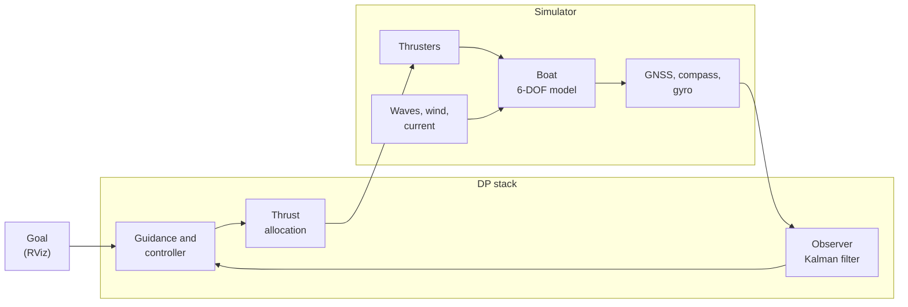

<div align="center">

# Cybership BlueBoat DP simulator

Simulator and dynamic positioning (DP) controller for *Microampere*, a BlueBoat catamaran used in my master's thesis at NTNU.


[Install](#install) · [First run](#first-run) · [Examples](#examples) · [Reference](#reference) · [Change the boat](#change-the-boat) · [How it works](#how-it-works)

</div>

---

## What it does

You give the boat a goal in RViz. It drives there and holds its position and heading while waves, wind and current push it around.

The boat model follows Fossen's marine craft equations. The added mass and damping come from running Capytaine on the hull CAD, so they are computed rather than guessed. Every number about the boat sits in one YAML file, and each part of the system (simulator, observer, controller, thrust allocation) is a separate ROS 2 node. That makes it easy to change the boat, or to swap the simulator for the real boat later.

---

## Install

You need Ubuntu 24.04 and ROS 2 Jazzy ([install guide](https://docs.ros.org/en/jazzy/Installation/Ubuntu-Install-Debs.html)). The rest takes about ten minutes.

```bash
# 1. system packages
sudo apt install ros-jazzy-desktop ros-dev-tools python3-venv python3-pip build-essential \
                 ros-jazzy-topic-tools ros-jazzy-nav2-msgs ros-jazzy-xacro

# 2. get the code
mkdir -p ~/ros_ws/src && cd ~/ros_ws/src
git clone --recursive https://github.com/alihsar1kaya/cybership_blueboat.git

# 3. Python packages, in a virtual environment that can still see ROS
cd ~/ros_ws
python3 -m venv venv --system-site-packages && touch venv/COLCON_IGNORE
source /opt/ros/jazzy/setup.bash && source venv/bin/activate
pip install -r src/cybership_blueboat/requirements.txt

# 4. build
sudo rosdep init 2>/dev/null; rosdep update
rosdep install --from-paths src -i -y --rosdistro jazzy
colcon build --symlink-install
```

Every terminal you open afterwards has to be sourced before ROS commands work:

```bash
cd ~/ros_ws && source /opt/ros/jazzy/setup.bash && source venv/bin/activate && source install/setup.bash
```

---

## Towing on Windows (WSL)

Step by step for the towing work on a Windows PC.

**1. Install Ubuntu** (PowerShell as administrator, then restart):

```powershell
wsl --install -d Ubuntu-24.04
```

**2. Install ROS 2 and this repo:** open "Ubuntu 24.04" from the Start menu and do every step in [Install](#install).

**3. Source every new terminal:**

```bash
cd ~/ros_ws && source /opt/ros/jazzy/setup.bash && source venv/bin/activate && source install/setup.bash
```

**4. Start the simulator with a load:**

```bash
ros2 launch cybership_simulator vessel.launch.py vessel:=microampere dp:=true observer:=true gnss:=rtk tow:=true
```

RViz opens. The orange ball is the load. Click **2D Goal Pose** on the map to move the boat. `Ctrl+C` stops it.

**5. Add weather** at the end of the launch line:

| Weather | Add |
|---|---|
| Waves | `waves:=true wave_hs:=0.1` |
| Wind | `wind_speed:=6 wind_dir:=90` |
| No RViz | `use_gui:=false` |

**6. Change weather while it runs** (second terminal, sourced as in step 3):

```bash
ros2 param set /microampere/sim environment.current.speed 0.1          # current on [m/s]
ros2 param set /microampere/sim environment.current.direction_deg 90   # towards east
ros2 param set /microampere/sim environment.waves.Hs 0                 # waves off
ros2 param set /microampere/sim environment.wind.speed 0               # wind off
```

Directions are where things move towards: 0 = north, 90 = east.

**7. Where things are:**

| What | Where |
|---|---|
| Load settings (mass, bar, tow point) | `cybership_config/config/microampere/vessel.yaml`, section `tow` |
| Load physics | `cybership_utilities/cybership_utilities/marine_craft/tow.py` |
| Bar force | topic `/microampere/sim/tow/tension` |
| Load cell | topic `/microampere/sensor/tow_force` |

Restart the launch after editing `vessel.yaml`. More on the model: [Towing a load](#10-towing-a-load).

**Only to talk to the real boat or another PC:** create `C:\Users\<you>\.wslconfig` with

```
[wsl2]
networkingMode=mirrored
```

and run `wsl --shutdown` (Windows 11 22H2 or newer). Gazebo (`gazebo:=true`) can be slow in WSL; towing does not need it.

---

## First run

```bash
ros2 launch cybership_simulator vessel.launch.py vessel:=microampere dp:=true
```

RViz opens with the boat at the origin. Pick **2D Goal Pose** in the toolbar, then click on the map where the boat should go and drag in the direction it should point. The guidance plans the whole move in about a second and the boat follows the plan: it turns while it drives where there is room, turns on the spot or backs up a little where that is shorter, and arrives pointing the way you chose. Once there it stays within a centimetre or two. The section [How it works](#how-it-works) explains what happens on the way.

Stop everything with `Ctrl+C` in the launch terminal.

---

## Examples

Each example is a complete command you can paste. They all start the controller (`dp:=true`), so you can give goals in RViz as in the first run.

### 1. Calm water, perfect knowledge

```bash
ros2 launch cybership_simulator vessel.launch.py vessel:=microampere dp:=true
```

The controller is given the true position and velocity straight from the simulator. This is the best the boat can do and a good baseline when you compare other settings.

### 2. Realistic sensors

```bash
# accurate RTK GNSS (about 2 cm)
ros2 launch cybership_simulator vessel.launch.py vessel:=microampere dp:=true observer:=true gnss:=rtk

# ordinary GNSS (about 20 cm noise and a slow drift of a few decimetres)
ros2 launch cybership_simulator vessel.launch.py vessel:=microampere dp:=true observer:=true
```

With `observer:=true` the controller no longer sees the truth. It gets GNSS, compass and gyro readings at their real rates, and a Kalman filter turns them into an estimate. With RTK the boat holds 1–2 cm. With ordinary GNSS it holds 5–15 cm, but it slowly wanders with the GNSS error because it has no way of knowing the receiver is wrong. That is why the real boat should have RTK.

### 3. Waves

Pick a wave height with `wave_hs` (in metres). The BlueBoat is built for calm water, so the useful range is small:

| Sea | Command addition | What you see |
|---|---|---|
| Light ripples | `waves:=true wave_hs:=0.02` | barely moves |
| Default | `waves:=true` (0.05 m) | rolls and pitches about 0.5° |
| Choppy for this boat | `waves:=true wave_hs:=0.1` | rolls and pitches about 1°, heaves 2 cm |

For example:

```bash
ros2 launch cybership_simulator vessel.launch.py vessel:=microampere dp:=true observer:=true gnss:=rtk waves:=true wave_hs:=0.1
```

You can also change the waves while the simulator runs. Open a second terminal and turn them up, down or off:

```bash
ros2 param set /microampere/sim environment.waves.Hs 0.03            # calmer
ros2 param set /microampere/sim environment.waves.Hs 0.1             # rougher
ros2 param set /microampere/sim environment.waves.Hs 0               # off
ros2 param set /microampere/sim environment.waves.direction_deg 90   # waves now travel towards east
ros2 param set /microampere/sim environment.waves.Tp 2.0             # shorter, steeper waves
```

The boat rocks with the waves, but the controller should not try to fight that motion. The Kalman filter separates the slow drift from the fast wave motion, so the thrusters stay calm. You can see this on `sim/path_lf` in RViz, the track without the wave motion.

### 4. Wind

```bash
ros2 launch cybership_simulator vessel.launch.py vessel:=microampere dp:=true observer:=true gnss:=rtk wind_speed:=8 wind_dir:=90
```

This is an 8 m/s wind (a fresh breeze, Beaufort 5) blowing towards east, so it hits the boat from the side. The bow thruster pushes back with about 6 N and the boat still holds within a centimetre.

```bash
ros2 param set /microampere/sim environment.wind.speed 12           # stronger
ros2 param set /microampere/sim environment.wind.direction_deg 180  # now blowing towards south
ros2 param set /microampere/sim environment.wind.sigma 0.5          # gusts on
ros2 param set /microampere/sim environment.wind.mu 0.1             # how quickly gusts die out [1/s]
```

### 5. Current

```bash
ros2 launch cybership_simulator vessel.launch.py vessel:=microampere dp:=true observer:=true gnss:=rtk
# then, in a second terminal:
ros2 param set /microampere/sim environment.current.speed 0.15
ros2 param set /microampere/sim environment.current.direction_deg 90
```

Current is the hardest load for this boat. Sideways it can only push back with the bow thruster, and a side current above roughly 0.25 m/s is more than that thruster can hold. Head-on the stern thrusters take it easily, so if the current gets strong, give the boat a goal heading that points the bow into it.

### 6. Everything at once

```bash
ros2 launch cybership_simulator vessel.launch.py vessel:=microampere dp:=true observer:=true gnss:=rtk \
    waves:=true wave_hs:=0.05 wave_dir:=45 wind_speed:=6 wind_dir:=90
ros2 param set /microampere/sim environment.current.speed 0.1      # in a second terminal
```

### 7. Without RViz

```bash
ros2 launch cybership_simulator vessel.launch.py vessel:=microampere dp:=true observer:=true gnss:=rtk use_gui:=false
```

Useful on a server or for automatic tests. Send goals from the terminal:

```bash
# 5 m north, 3 m east, heading 45° (quaternion z = sin(45°/2), w = cos(45°/2))
ros2 topic pub --once /goal_pose geometry_msgs/msg/PoseStamped \
  "{header: {frame_id: world}, pose: {position: {x: 5.0, y: 3.0}, orientation: {z: 0.383, w: 0.924}}}"
```

The scripts in [`tools/`](tools/README.md) do this for you and log the result. This one moves the boat 10 m north in a side current and prints the path length and how well it held position afterwards:

```bash
GOAL="10 0 0" CURRENT="0.15 90" bash src/cybership_blueboat/tools/run_goal_motion_test.sh demo 0 observer:=true gnss:=rtk
```

### 8. Sensor delays and GNSS problems

The simulator delays the sensors and the thruster commands the way real hardware does: GNSS arrives about 0.1 s after the measurement, and a thruster reacts about 0.05 s after the command. The values are under `latency` in `vessel.yaml`. The Kalman filter knows when each GNSS fix was taken and corrects for the delay.

You can also take the GNSS away while the boat holds position:

```bash
ros2 launch cybership_simulator vessel.launch.py vessel:=microampere dp:=true observer:=true gnss:=rtk
# in a second terminal:
ros2 param set /microampere/sim sensors.gnss.available false   # GNSS gone
ros2 param set /microampere/sim sensors.gnss.available true    # back
ros2 param set /microampere/sim sensors.gnss.rtk_fix false     # RTK fix lost, accuracy drops to ~20-50 cm
ros2 param set /microampere/sim sensors.gnss.rtk_fix true      # fix back
ros2 param set /microampere/sim sensors.gnss.outage_rate 1     # random outages, about one per minute
```

Without GNSS the filter keeps going on the boat model and the compass (dead reckoning), and the observer prints a warning. In a 0.1 m/s current the boat drifted at most 8 cm during a 20 s outage, then returned once GNSS came back. Losing the RTK fix is worse: the boat follows the receiver's slow error and wanders 20–40 cm, because nothing tells it the position is wrong.

### 9. Battery voltage and thrust at speed

The thrusters lose force in two ways, as on the real boat. A lower battery voltage gives less thrust for the same command (the T200 gives 6.7 kgf at 20 V but 5.25 kgf at 16 V), and a propeller pushes less the faster water flows into it, so the thrust falls as the boat picks up speed.

```bash
ros2 launch cybership_simulator vessel.launch.py vessel:=microampere dp:=true observer:=true gnss:=rtk
# in a second terminal:
ros2 param set /microampere/sim battery.voltage 14.8                 # a 4S battery, about 70 % of full thrust
ros2 param set /microampere/sim environment.current.speed 0.2
ros2 param set /microampere/sim environment.current.direction_deg 90
```

The controller is not told about the voltage, so it has to make up for the weaker thrusters through its bias estimate. At 14.8 V in a 0.2 m/s side current the boat held within 6 cm, against 2 cm at full voltage, with the bow thruster close to its limit.

### 10. Towing a load

Another BlueBoat group is going to tow something, so the simulator can pull a load behind the boat. Towing is off by default. Turn it on with `tow:=true`:

```bash
ros2 launch cybership_simulator vessel.launch.py vessel:=microampere dp:=true observer:=true gnss:=rtk tow:=true
# the same in waves
ros2 launch cybership_simulator vessel.launch.py vessel:=microampere dp:=true observer:=true gnss:=rtk tow:=true waves:=true wave_hs:=0.2
```

With `tow:=false` (or without the argument) none of what follows runs. There is no load, no load cell and no change to the controller, so the boat behaves as it always has.

The default load is a 30 kg float on a 2 m towbar fixed to the stern. The float is a point mass with the drag, added mass and wave forces of a half-submerged sphere of the same displacement (radius 0.24 m). The bar is pinned at both ends, so it pulls and pushes but swings freely to the sides. In RViz the load is an orange ball, and the bar is red while it pulls, blue while it pushes and grey when it carries almost nothing. The bar force is published on `sim/tow/tension`, negative while the bar pushes.

When the load is on, the DP stack knows about it too (`tow_model:=true`, the default). The trajectory planner and the controller add the load's 45 kg (mass plus added mass) and its drag in surge, so plans brake earlier and the gains match the heavier boat. A simulated 2-axis load cell at the tow point publishes the bar force on `sensor/tow_force`, and the Kalman filter takes it as a known force. Before the load cell was added, the sideways pull of the bar in a turn ended up in the bias estimate (up to 24 N) and held the boat 20–70 cm off the goal for half a minute.

Add `tow_model:=false` to watch the boat tow without any of this. In our tests it overshot a 4 m move by about a metre and kept surging back and forth; with the model on, the overshoot was 20 cm and it held within a few centimetres.

The controller does not cancel the load cell force directly. We tried that and it went unstable in yaw. Seen from the stern, the load has more rotational inertia than the boat itself (45 kg × 0.6² m² ≈ 16 kg m², against 9.4 kg m²), and a filtered measurement always arrives a little too late to cancel it.

Everything about the load is in the `tow` section of `vessel.yaml`. There you can swap the float for a 1.2 × 0.5 m hull with a heading of its own (`body.type: hull`), use a rope that only pulls (`line.rigid: false`), or change the bar length, the mass, the tow point and the load cell noise. All of these are guesses until we know what the towing group tows and how they attach it.

### 11. Obstacles

The trajectory planner can steer around round obstacles. Start the simulator as usual, pick the 2D Pose Estimate tool in RViz's toolbar and click in the water: each click drops an obstacle with a radius of 0.5 m (a red cylinder). The RViz config sends that tool to the obstacle manager instead of `/initialpose`, which nothing here uses. Publish Point works too, but only when you click on something that is drawn, such as a grid line. Then set a goal behind the obstacle with 2D Goal Pose. The planned track shows up as a green line before the boat starts moving.

```bash
ros2 launch cybership_simulator vessel.launch.py vessel:=microampere dp:=true observer:=true gnss:=rtk
# remove the clicked obstacles again, all or the last one
ros2 service call /microampere/obstacle_manager/clear std_srvs/srv/Trigger
ros2 service call /microampere/obstacle_manager/undo std_srvs/srv/Trigger
# bigger obstacles from the next click on
ros2 param set /microampere/obstacle_manager radius 1.0
```

Fixed obstacles, a dock for example, go in a YAML file that you pass with `obstacles:=<file>`:

```yaml
obstacles:
  - [8.0, 0.0, 0.8]     # x north, y east, radius [m]
  - [8.0, 1.5, 0.8]
```

The boat keeps its hull at least 0.5 m away from every obstacle in the plan (`guidance.ocp.obstacle_margin`). In tight turns it falls up to about 0.4 m behind the plan, so the real gap is smaller; in our tests it never got closer than 0.14 m. Planning takes 1–3 s for most goals and up to about 10 s for awkward ones, and the boat holds position meanwhile. If no plan is found, the boat stays where it is and the controller logs an error. Then try a goal a bit further from the obstacles. Near the start and the goal the margin shrinks to whatever room the hull has there, so you can put a goal close behind an obstacle (the log says how close). A goal where the hull would overlap an obstacle is refused, and an obstacle dropped on top of the boat is left out so the boat can get away from it.

### 12. The real boat's topics and Foxglove

The real Microampere talks through TURLab's `blueboat_interfaces` messages, not through this suite's own topics. With `boat_interface:=true` the simulator speaks that language too, so the boat's software can run against it unchanged and our DP can drive the real boat later without rewriting:

```bash
ros2 launch cybership_simulator vessel.launch.py vessel:=microampere dp:=true observer:=true gnss:=rtk boat_interface:=true foxglove:=true
```

The simulator then takes the aft thrust on `/control/thrust` and the azimuth on `/actuator/azimuth_cmd`, as the boat's drivers do. The azimuth turns to an absolute, unwrapped angle like the stepper on the boat. Out come `/navigation/odometry/ned` (what the boat's LEKF filter publishes), `/sensors/imu` in the STIM300's frame and units, the u-blox messages `/sensors/nav_pvt`, `/sensors/ecef`, `/sensors/nav_cov` and `/sensors/rel_pos` from the two antennas, `/control/opmode`, `/azimuth/state` and `/battery`. Antenna and IMU positions, noise and the PWM map come from the boat's own configuration files and sit in the `boat_interface` section of `vessel.yaml`. Our allocation publishes on the boat's topics in this mode and keeps the azimuth within 1.5 turns of zero, as the cable allows.

Our DP also speaks the interface of the team's own pose controller (`blueboat_core_control`) in this mode, so either side can be swapped for the other:

| Topic or service | Type | What |
|---|---|---|
| `/control/opmode` | `OperationMode` (in, latched) | the DP drives only in AUTONOMOUS. When it becomes active it holds the pose it has; when it stops being active it drops the target |
| `/start_operation` | `Bool` (in, simulator) | START / STOP OPERATION: switches the simulated boat to AUTONOMOUS or STOPPED |
| `/goal_pose` | `PoseStamped` (in) | target in frame `ned` or `world` (the same thing here), `enu`, or `base_link` (relative to the boat) |
| `/control/pose/setpoint` | `Waypoint` (in) | target `xn`, `yn` [m], `psi_n` [rad], NED |
| `/control/tau` | `WrenchStamped` (out) | the demanded force in BODY: surge `force.x`, sway `force.y`, yaw `torque.z` |
| `/control/pose/{target, reference, state}` | `Waypoint` | goal, the reference the DP follows (filter or OCP plan) and the estimate, NED |
| `/control/pose/{error, integral}` | `Vector3Stamped` | reference minus state, and the integral (x, y, yaw) |
| `/control/pose/{tau_feedforward, tau_feedback}` | `WrenchStamped` | the model part (M and D) and the gain part (P, D, and the integral or the observer's bias) |
| `/control/pose/{active, status, gains, period}` | `Bool`, `String`, `String` (JSON), `Float64` | gate state, why it is inactive, gains, loop period [s] |
| `/control/pose/{hold, reset, reset_integral}` | `Trigger` services | hold the current pose; seed the filter on the current state and clear the integral; clear the integral |
| `/control/allocator/tau_allocated` | `WrenchStamped` (out) | the force the sent thrusts give (the observer uses this as its input) |
| `/control/allocator/unwinding` | `Bool` (out) | the azimuth is swinging the long way round, without thrust |

The allocation reads `/control/tau` in this mode and sends thrust only in AUTONOMOUS. When the mode changes it sends one zero command and then stays quiet, so it never fights the joystick. If no force has come for 0.5 s it sends zero. The goal client is not started, because the controller reads `/goal_pose` itself. RViz's 2D Goal Pose and the web GUI therefore still work, and the web GUI's STOP sends STOP OPERATION. Our own extras (the OCP plan, obstacles, the observer's current and bias) stay under `/microampere/...`.

`foxglove:=true` starts `foxglove_bridge` on `ws://localhost:8765`. Open it in Foxglove Studio (the desktop app or app.foxglove.dev) and import the team's layout with Layouts, then Import from file. The file is `microAmpere.json` in TURLab's `blueboat_foxglove` repository. In its DP tab the operation mode, active indicator, hold and reset buttons, setpoint panel, target and reference plots, the demanded against allocated force and the azimuth indicator all work. The simulator publishes static transforms from `world` to `ned`, from `ned` to `enu`, and from the boat to `base_link` (the IMU), so the 3D panel can show the poses and you can drag a goal there. The LEKF, LiDAR, timing and radio tabs stay empty, since they need the boat's own nodes.

#### The observer on the boat's navigation

In this mode the observer reads the boat's LEKF odometry, `/navigation/odometry/ned`, instead of the simulator's
`sensor/gnss` and `sensor/imu`. That is the input it will have on the real boat. The boat has no compass: the
STIM300 gives rates and accelerations only, and the LEKF's heading comes from the two GNSS antennas. The LEKF
publishes the IMU's pose. The observer moves it to the boat's centre with `boat_interface.imu_position` and uses
the position (`lekf.sigma_position`, 2 cm) and the heading (`lekf.sigma_heading_deg`, 0.5 deg) as measurements.
The lidar's quay faces come on top, as in example 14.

On the boat every `/sensors/*` and `/navigation/*` stamp is SentiBoard time. That clock counts from 2000-01-01
and restarts with its node, so it is 26 years from the computer's clock. The observer never compares such a stamp
with `now()`. It maps the stamps to its own clock with the shortest delay it has seen
(`blueboat_io.StampClock`), which keeps the time between measurements right for the delay compensation. Try it
in the simulator, which then stamps the boat's topics the same way:

```bash
ros2 launch cybership_simulator vessel.launch.py vessel:=microampere dp:=true observer:=true gnss:=rtk boat_interface:=true boat_clock:=sentiboard x0:=1 y0:=-2 yaw0_deg:=100
```

The quays in `harbour.yaml` are in the map's NED frame, which starts at the origin in `vessel.yaml`
(`sensors.gnss`). The LEKF starts its NED frame at its first fix unless `ned_reference_ecef` pins it. The
observer compares `/navigation/ned_origin` with the map's origin and logs an error when they are more than
0.5 m apart. On the boat, pin the LEKF's origin to the map's.

With `multipath:=true` the simulated LEKF odometry gets the same multipath error as the GNSS fix, because the
real LEKF follows its GNSS.

Our own force topic `control/force/command/mux` is a `Wrench` with no header. To plot it in Foxglove, give the full path (`/microampere/control/force/command/mux.force.x`) and set the timestamp to receive time.

`blueboat_interfaces` lives on TURLab's GitLab and has to sit next to this repository in `ros_ws/src`:

```bash
cd ~/ros_ws/src && git clone https://turlab.itk.ntnu.no/turlab/blueboat_interfaces.git
```

### 13. Docking

The boat can lay itself alongside a quay. The quays and berths are in `cybership_config/config/<vessel>/harbour.yaml`.
The launch file finds it on its own, and for small_harbour it matches the dock in the Gazebo world: 6 x 1.5 m, 8 m
north. Start somewhere south of the dock and ask for the berth:

```bash
ros2 launch cybership_simulator vessel.launch.py vessel:=microampere dp:=true observer:=true gnss:=rtk x0:=1 y0:=-2 yaw0_deg:=100
```

```bash
ros2 topic pub --once /microampere/guidance/dock std_msgs/String "data: dock_south"
```

Or click "2D Goal Pose" in RViz within 1 m of the berth: a goal next to a berth starts docking there, and the
arrow's direction picks the side (east: port side to the quay, west: starboard). Any other goal near the quay is
refused, because the ordinary planner keeps clear of the quay.

The web GUI's "Legg til kai" button does the same. So does the service
`ros2 service call /microampere/position_controller/dock std_srvs/srv/Trigger`, which docks at the first berth in
the file. In Foxglove, a Publish panel on `/microampere/guidance/dock` or a Call Service panel on the service works
too.

RViz shows the quay (brown), the berth (green arrow) and the plan (`guidance/plan`). `guidance/dock_status` says
which phase the boat is in:

1. If the boat is far off, behind the quay or past its end, it first goes to a stand-off pose 2 m out from the berth
   with the ordinary planner. The quay is given to that planner as circles.
2. The docking planner (`cybership_dp/docking_mpc.py`) plans the approach while the boat holds its position. The
   plan:
   - keeps the four hull corners at least 8 cm off the face,
   - slows the boat down as it closes in,
   - brings it in from in front of the berth, with the heading already lined up,
   - takes the observer's current and bias into account.
3. The DP law tracks the plan. It plans again only if the boat gets 0.25 m or 10 deg off the plan, and never in the
   last metre.
4. Alongside, the boat rests on its fenders. Along the face and in heading the DP holds the berth. Across it the
   force towards the quay is at least `docking.push_force` (8 N), so the boat lies gently against the fenders.
   If wind or current pull it off harder than that, the DP's own force wins and it holds the berth 10 cm off. Set
   `docking.push_force` to 0 to hold 10 cm off with DP only:
   `ros2 param set /microampere/position_controller docking.push_force 0.0`.

A new goal, STOP, or (with `boat_interface:=true`) leaving AUTONOMOUS ends docking. The design and the tests behind
it are in `results/docking_mpc_plan.md` in the workspace. To test docking without ROS, many runs at once, there is
`tools/docking_bench.py`. To test it through the whole ROS stack, there is `tools/docking_ros_test.py`.

The quays are solid in the simulator too. Points along the hull's outline (the fender line) that get inside a quay
are pushed out by a spring-damper that only pushes, with friction along the face. A corner touch also turns the boat.
The fender settings are in `vessel.yaml`'s `contact` section, and they are estimates: about 3000 N/m per point, a
soft fender that stops the boat from 0.3 m/s in about 3 cm. RViz draws the fender forces as orange arrows (1 cm per N),
and the total force is on `sim/contact`. A strong current or wind onto the quay now presses the boat against the
fenders instead of through the quay.

### 14. Lidar and the quay detector

With Gazebo the boat carries its lidar: an Ouster OS1-32 at the calibrated mounting from the real boat (`vessel.yaml`
`lidar`), rendered by Gazebo and published on `/ouster/points` as on the boat. The water is invisible to it, as
near-infrared mostly is. A quay detector fits the quay face in each scan and the observer uses it:

```bash
ros2 launch cybership_simulator vessel.launch.py vessel:=microampere dp:=true observer:=true gnss:=rtk gazebo:=true x0:=1 y0:=-2 yaw0_deg:=100
```

`quay_detector_node.py` levels the cloud with the observer's roll and pitch. It drops the water, the boat's own hull
and points outside 0.5-15 m, and fits a straight line with RANSAC. The map and the estimated pose say where the face
should be, so only points within 0.5 m of that are used. Its output is `perception/quay`: the distance from the
boat's centre to the face and the angle of the face's normal, with their uncertainties. The magenta line in RViz is
the fit. In Gazebo the distance is right to 0.8 cm on the way in (2.9 cm at most) and 0.2 cm alongside, and the angle
to 0.3 deg. Real data will be worse: no flat walls, wake, rain and mirror images in calm water.

The observer matches each face to the mapped quay (within 0.5 m and 10 deg). It then corrects the position across
the face and the heading, so near the quay the boat's distance to it comes from the lidar and only the position along
it from GNSS. While faces keep coming (the last second), GNSS corrects only along the face
(`quay.gnss_along_only`). With both on that axis the estimate ended halfway between them: with RTK and a 10 cm map
error the DP still thought it had 5 cm left.

The observer also keeps its estimate out of the mapped quays (`quay.constrain`). The fenders stop the boat with a
force the model does not know. Without the constraint the estimate went on 5-9 cm into the quay after the boat
touched, and took 10 s to come back. When the estimated hull is behind a quay face, the filter gets two
pseudo-measurements: the position on the face, and no velocity into it. Alongside, the estimate's error went from
4-5 cm to about 1 cm RMS.

Two launch arguments test why the lidar matters:

- `map_shift:="0.1 0.0"` moves the DP's quay map 10 cm north of the real quay. The simulator and Gazebo keep the true
  one.
- `multipath:=true` adds 0.1 m of noise and a slow 0.15 m bias to the GNSS within 3 m of a quay, while the receiver
  keeps reporting RTK accuracy.

`gz_gui:=false` runs Gazebo without its window (rendering headless, for tests), and `lidar:=false` leaves the lidar
out.

#### Seeing what the lidar does

With RTK and a correct map there is nothing for the lidar to fix, so you will not see a difference. Give the DP a
wrong map, dock, and switch the lidar off and on while the boat lies alongside:

```bash
ros2 launch cybership_simulator vessel.launch.py vessel:=microampere dp:=true observer:=true gnss:=rtk gazebo:=true x0:=1 y0:=-2 yaw0_deg:=100 map_shift:="0.10 0.0"
```

```bash
ros2 param set /microampere/dp_observer quay.enabled false
```

```bash
ros2 param set /microampere/dp_observer quay.enabled true
```

`docking_viz_node.py` (started with any harbour) draws the RViz display "Sant mot tenkt": the true hull and the true
quay in white, and in orange where the DP thinks the boat lies relative to the quay (the estimate minus the map
error). Orange on top of white means the DP knows the gap. The text over the boat gives both gaps and whether lidar
faces went into the filter. The yellow dots are the last 50 GNSS fixes, which scatter near the quay with
`multipath:=true`. The same numbers are on `viz/gap_true` and `viz/gap_believed` for plotting in Foxglove.

Alongside, with the map 10 cm off:

| | DP thinks the gap is | true gap |
|---|---|---|
| lidar off | 9.3-11.3 cm | 0 (on the fender) |
| lidar on | -0.8 to 0.1 cm | 0 |

### 15. Timing: will it keep up on the boat's computer?

The observer, the position controller, the allocation and the quay detector report how long their loops take on
`/diagnostics`, the topic the boat's Foxglove layout shows in its Diagnostics tab. Each loop sends the mean, 95th
percentile and largest compute time, the longest time between two calls, and its CPU share every two seconds. The
docking and transit OCP solves are reported the same way (`cybership_utilities/loop_timing.py`).

The boat's LattePanda Delta 3 has a Celeron N5105, about half as fast per core as a recent laptop, and it also
runs the LEKF and the sensor nodes. `dp_prefix` puts the DP nodes on fewer cores, and `tools/timing_test.py` adds
a busy loop on each of them:

```bash
python3 tools/timing_test.py --label laptop
python3 tools/timing_test.py --cores 1 --burn --label half1
```

Three dockings in current onto the quay, each through the boat's topics with the LEKF input:

| | laptop | 2 cores at half speed | 1 core at half speed |
|---|---|---|---|
| docked | 3/3 | 3/3 | 3/3 |
| control loop, largest | 6.5 ms of 100 | 14.7 ms | 14.5 ms |
| filter step, largest | 6.3 ms of 20 | 11.3 ms | 10.1 ms |
| docking OCP, mean / largest | 0.54 / 0.88 s | 1.76 / 2.65 s | 1.95 / 3.25 s |
| docking OCP solves | 6 | 14 | 15 |

The loops have plenty of margin. The control loop does not stall while the OCP solves in its thread, because CasADi
releases Python's GIL. The OCP was the limit: on a slow core it took up to 3 s, the boat drifted further from each
plan before the next one arrived, and it needed twice as many.

The docking OCP is now compiled to C. The first start of the position controller compiles it (about 30 s on the
laptop, longer on the boat's computer) and caches the library in `~/.cache/cybership_dp`; later starts load it at
once. Replans also warm start the multipliers. On one core at half speed a plan now takes 0.29 s on average and
0.84 s at most (it was 1.95 and 3.25 s), and three dockings needed 10 plans instead of 15. To measure the solver
alone:

```bash
python3 tools/docking_ocp_speed.py
```

### Switching the controller off and on

```bash
ros2 service call /microampere/position_controller/change_state std_srvs/srv/SetBool "{data: false}"   # thrusters to zero
ros2 service call /microampere/position_controller/change_state std_srvs/srv/SetBool "{data: true}"    # back on
```

---

## Reference

### Launch arguments

Add them to the end of the `ros2 launch` line as `name:=value`. They are read once at start.

| Argument | Default | Unit | Meaning |
|---|---|---|---|
| `vessel` | `voyager` | | which boat; loads `cybership_config/config/<vessel>/vessel.yaml` |
| `dp` | `false` | | start the controller, guidance and thrust allocation |
| `observer` | `false` | | feed the controller from simulated sensors and a Kalman filter instead of the true state |
| `gnss` | `standard` | | `standard` or `rtk`; both profiles are defined in `vessel.yaml` |
| `noisy_odom` | `false` | | without the observer: give the controller the true state plus white noise |
| `waves` | `false` | | start with waves |
| `wave_hs` | `0.05` | m | significant wave height; keep it below about 0.15 m for this boat |
| `wave_tp` | `2.3` | s | peak period; 1.5–3 s fits short, wind-driven waves |
| `wave_dir` | `0` | deg | direction the waves travel towards |
| `wind_speed` | `0` | m/s | mean wind speed |
| `wind_dir` | `0` | deg | direction the wind blows towards |
| `boat_interface` | `false` | | the real Microampere's topics (`blueboat_interfaces`): `/control/thrust` and `/actuator/azimuth_cmd` in, `/navigation/odometry/ned` and `/sensors/*` out; our DP speaks the team's interface (`/control/opmode`, `/goal_pose`, `/control/tau`, `/control/pose/*`), and the observer reads the LEKF odometry |
| `boat_clock` | `ros` | | with `boat_interface`: stamps of the boat's topics, `ros` or `sentiboard` (epoch 2000, as on the boat) |
| `foxglove` | `false` | | start `foxglove_bridge` on `ws://localhost:8765` |
| `harbour` | `auto` | YAML | quays and berths for docking; `auto` = `cybership_config/config/<vessel>/harbour.yaml` if it exists |
| `x0`, `y0`, `yaw0_deg` | `0` | m, m, deg | start pose (north, east, heading) |
| `lidar` | `true` | | with `gazebo:=true`: the Ouster on `/ouster/points` and the quay detector |
| `gz_gui` | `true` | | with `gazebo:=true`: the Gazebo window; `false` = server only, headless rendering |
| `map_shift` | `0.0 0.0` | m, m | test: the DP's harbour map moved north, east from the true quay |
| `multipath` | `false` | | test: GNSS multipath within 3 m of a quay |
| `obstacles` | (none) | | YAML file with fixed round obstacles for the planner (`obstacles: [[x, y, r], ...]`); more can be clicked in RViz |
| `tow` | `false` | | tow a load behind the boat (`vessel.yaml` `tow`: a 30 kg point mass on a 2 m towbar by default) |
| `tow_model` | `true` | | with `tow`: the DP controller and the trajectory planner use the load's mass and drag in surge, and the observer takes the simulated load cell's force (`sensor/tow_force`) as a known input. Without `tow` none of this runs |
| `use_gui` | `true` | | start RViz |
| `gazebo` | `false` | | also show the boat in a Gazebo world (needs `ros_gz`; our model stays the physics, Gazebo only draws it) |
| `gz_world` | `small_harbour` | | `small_harbour` (light, with a dock) or a VRX world such as `sydney_regatta` |

### Weather and sensors while running

Change these with `ros2 param set /microampere/sim <name> <value>`. They take effect at once.

| Parameter | Default | Unit | Meaning |
|---|---|---|---|
| `environment.waves.Hs` | from `wave_hs` | m | wave height, 0 turns the waves off |
| `environment.waves.Tp` | from `wave_tp` | s | peak period |
| `environment.waves.direction_deg` | from `wave_dir` | deg | travel direction |
| `environment.waves.spreading` | `1` | | 1 for short-crested (realistic) waves, 0 for long, parallel crests |
| `environment.wind.speed` | from `wind_speed` | m/s | mean wind speed, 0 turns the wind off |
| `environment.wind.direction_deg` | from `wind_dir` | deg | direction the wind blows towards |
| `environment.wind.sigma` | `0` | m/s/√s | gust strength, 0 for steady wind |
| `environment.wind.mu` | `0` | 1/s | how fast gusts return to the mean |
| `environment.current.speed` | `0` | m/s | current speed, 0 turns it off |
| `environment.current.direction_deg` | `0` | deg | direction the current flows towards |
| `battery.voltage` | `20` | V | battery voltage; lower gives less thrust (T200 thrust-voltage curve) |
| `sensors.gnss.available` | `true` | | false simulates a GNSS outage |
| `sensors.gnss.rtk_fix` | `true` | | false makes an RTK receiver fall back to normal accuracy (only with `gnss:=rtk`) |
| `sensors.gnss.outage_rate` | `0` | 1/min | random outages per minute, 0 for none |
| `sensors.gnss.outage_duration` | `10` | s | length of each random outage |

Directions use the marine convention: x is north, y is east, and 90° is east. Wind, waves and current are all given as the direction they move towards, so a wind coming from the north is `wind_dir:=180`.

---

## Change the boat

All boat data is in [`cybership_config/config/microampere/vessel.yaml`](cybership_config/config/microampere/vessel.yaml). The simulator, the controller and the observer read the same file, so you only change things in one place. Edit it and restart the launch; you don't need to rebuild.

| Section | Contents |
|---|---|
| `model` | mass, inertia, hydrodynamics, damping and the wind areas |
| `thrusters` | one entry per thruster with position, direction and strength |
| `sensors` | rate and noise for GNSS, compass and gyro |
| `thruster_model` | battery voltage, thrust-voltage curve and how fast thrust drops with speed |
| `latency` | delays of GNSS, IMU and thruster commands, in seconds |
| `tow` | the towed load: point mass or a hull with heading, towbar or rope, its length and stiffness, where it attaches |
| `allocation` | how the total force is split between the thrusters, when the azimuth is allowed to turn (`angle_threshold`) and whether the thrust lost at speed is compensated (`inflow_compensation`) |

Each value has a comment saying where it came from. The ones marked ESTIMATE still need measuring on the real boat; [`tools/identification.md`](tools/identification.md) describes the tests and `tools/identify.py` turns the logs into values for this file.

<details>
<summary>Changing a thruster</summary>

```yaml
thrusters:
  - name: port
    type: fixed                     # fixed or azimuth (rotating)
    frame: stern_port_thruster_link # link in the URDF, used by RViz
    position: [-0.55, -0.29, 0.177] # [m] x forward, y starboard, z down
    direction_deg: 0.0              # 0 pushes forward
    max_force: 67.0                 # [N]
    reverse_ratio: 0.8              # reverse thrust is 80 % of forward
```

To make it stronger, raise `max_force`. To move it, change `position`. You can delete a thruster or copy one with a new `name` and `position`; the allocation works with whatever thrusters are listed. Without the bow thruster the boat can no longer push sideways, so expect it to drift in a cross current.
</details>

<details>
<summary>Making the controller faster or calmer</summary>

The settings are in [`cybership_config/config/microampere/controller_position.yaml`](cybership_config/config/microampere/controller_position.yaml). The gains are computed from the boat model, so you mostly choose how fast it should react.

| Setting | Higher | Lower |
|---|---|---|
| `control.omega_n` | holds tighter and uses more thrust | softer |
| `filter.omega` | reaches a new goal sooner | smoother moves |
| `guidance.ocp.w_v` | less sideways motion | more crabbing with the bow thruster |
| `guidance.ocp.w_r` | gentler turning, more arcs | quicker turns, more turning on the spot |
| `guidance.ocp.w_rev` | backs up less | backs up more often |
| `guidance.ocp.w_f`, `w_df` | calmer, slower moves | quicker moves with more thrust |
| `guidance.forward_speed` | faster transit | slower transit |
| `guidance.sway_speed` | faster sideways moves, until the bow thruster saturates (0.2 m/s takes about 45 of its 67 N) | gentler on the bow thruster |
| `guidance.max_turn_rate_deg_s` | quicker turns; above about 30 °/s the stern thrusters saturate and the boat slides off the spot | slower turns |
| `guidance.max_dp_distance` | longer moves are done without turning first | the boat turns and drives more often |
| `guidance.dubins_radius` | wider, gentler curves | tighter turns; 0 switches the curves off (turn on the spot, drive straight, turn again) |

The `guidance.ocp` weights shape the planned moves (everything up to 25 m). The Dubins settings below them only matter for longer moves. You can change them while it runs, for example `ros2 param set /microampere/position_controller guidance.ocp.w_rev 15.0`.
</details>

<details>
<summary>Adding your own boat</summary>

1. Copy the folder: `cp -r cybership_config/config/microampere cybership_config/config/myboat`
2. Edit `myboat/vessel.yaml`. If you have no Capytaine results, delete `model.hydro` and set `added_mass` by hand.
3. Rebuild once so the new folder gets installed: `colcon build --symlink-install --packages-select cybership_config`
4. Start it with `vessel:=myboat`.

If the boat has no URDF yet it still runs, but RViz only shows the coordinate frames.
</details>

---

## How it works

The layout follows Fossen's guidance, navigation and control diagram. Each box below is its own node and they only talk through topics. To run on the real boat, you replace the simulator box with the sensor and thruster drivers and leave the rest alone.



### The ideas in short

The simulator moves the boat with Fossen's 6-DOF equations of motion, M ν̇ + C(ν)ν + D(ν)ν + g(η) = τ + τ_env. M holds the mass plus the added mass (the water the hull has to push along), D the damping and g the restoring forces from buoyancy. The added mass, damping and restoring terms come from Capytaine, a panel code run on the CAD hull, so they follow the BlueBoat's real shape rather than a box. Wind, waves and current add their own forces, and each thruster loses some thrust as the boat speeds up.

The DP stack never sees that true state. It gets GNSS positions at 5 Hz, a compass and a gyro, all with noise and delays, and a Kalman filter turns them into an estimate using a simpler 3-DOF version of the same model. Between GNSS fixes the filter predicts where the boat should be from the forces it is pushing with, and each fix corrects the guess. Besides position, heading and velocity it estimates the current and a slowly varying bias force. The bias collects whatever the model gets wrong, such as wind or a damping value that is off, and the controller cancels it.

When you give a goal, the guidance plans the whole move at once. Microampere has three thrusters, one of them a rotating bow azimuth, so it can push forwards, push sideways and turn independently. Fossen calls this fully actuated, and for such a boat at low speed the textbook answer is trajectory tracking: plan where the boat should be at every moment, then make it follow. The planner solves an optimal control problem with CasADi and IPOPT. It looks for the thrust from each thruster, second by second, that brings the boat from where it is to the goal pose at rest without exceeding the thrust and speed limits, at the lowest cost. The cost adds up time, sideways speed, yaw rate, backing up and thrust, each with a weight. Raise a weight and the boat does less of that; whether to turn while driving, turn on the spot or back up falls out of the optimization instead of a set of rules. NTNU's autonomous ferry milliAmpere plans its moves the same way. Moves longer than 25 m use a Dubins path followed with adaptive line-of-sight (ALOS) guidance instead, which suits long transits at speed.

The controller then follows the plan. It works out the force the model says is needed to move along it (mass times acceleration plus damping), adds a correction in proportion to the position and velocity error, and subtracts the bias from the Kalman filter. The gains come from pole placement on the model, so the main tuning knob is how fast it should react (`control.omega_n`).

Last, the thrust allocation splits the requested forces and turning moment between the three thrusters. It solves a small quadratic program that respects each thruster's limit and the slow rotation of the azimuth. When the request is more than the thrusters can give, it keeps the heading and gives up some surge and sway first.

### The trajectory planner

The planner in `cybership_dp/trajectory_planner.py` solves one optimal control problem per goal. Its model is the 3-DOF version of the boat that the rest of the DP stack uses, with the thrust from each thruster as the input:

```
η̇ = R(ψ) ν                           η = [x, y, ψ]   position and heading
M ν̇ + C(ν) ν + D(ν) ν = B f          ν = [u, v, r]   surge, sway and yaw rate
                                     f = thrust from each thruster
```

M and D come from `vessel.yaml`, so the planner and the simulator agree on how heavy the boat is and how much the water holds it back. B turns the thruster forces into surge force, sway force and yaw moment. That is how the planner knows the stern thrusters cannot push sideways and the bow azimuth can.

The move is split into N = 40 steps of length T/N, and the planner looks for the states, thrusts and total time T that minimise

```
J = w_T T + Σ Δt ( w_v v² + w_r r² + w_rev min(u, 0)² + w_f |f / f_max|² + w_df |Δf / f_max|² )
```

subject to

```
the model between the steps            (Runge-Kutta 4, multiple shooting)
start = the boat now,  end = the goal pose with ν = 0
−0.8 f_max ≤ f_port, f_starboard ≤ f_max,   f_x² + f_y² ≤ f_max²   (bow azimuth, f_max = 67 N)
−0.35 ≤ u ≤ 0.6 m/s,   |v| ≤ 0.3 m/s,   |r| ≤ 25°/s
```

Because T is one of the unknowns, the planner also decides how fast to go. The first term pays for time. The next three make sideways motion, turning and backing up expensive, and the last two charge for thrust and for changing it quickly, which keeps the thrusters calm. With the default weights (w_T 1, w_v 30, w_r 5, w_rev 8, w_f 2, w_df 20) the boat mostly turns while it drives and only crabs or backs up when that saves real time. For a turn on the spot there is one extra term that keeps the boat on its start point. With a towed load, the planner adds the load's mass and drag in surge.

Obstacles are circles with centre (x_o, y_o) and radius r_o. The hull is covered by three circles along the centre line (`footprint` in `vessel.yaml`), and at every step each of them has to stay clear:

```
(x_c − x_o)² + (y_c − y_o)² ≥ (r_o + r_c + margin)²
```

This makes the problem non-convex, and IPOPT only finds the best plan near the guess it starts from. Which side to pass on therefore has to be decided before the solve. When an obstacle blocks the straight line, the planner builds one guess that swings out to port and one to starboard, tries the shorter one first and keeps the first plan that solves. It manages about 17 of 20 random cases with one to three obstacles. The ones it misses have obstacles packed close together at an angle to the course, and a proper search for the initial path (hybrid A*, as on milliAmpere) would fix those.

IPOPT solves the problem in 0.2–3 s, in its own thread, while the boat keeps holding position. The controller then follows the planned pose, velocity and acceleration with model feedforward:

```
τ = M ν̇_d + D(ν_d) ν_d + K_p e + K_d ė − R(ψ)ᵀ b̂
```

Here e is the error to the plan and b̂ the bias force from the Kalman filter. Fossen (2021, section 12.1.3) describes the same scheme, an optimal guidance system with J = min{power, time} in front of the controller. His example plans for a kinematic model that can only drive forward and turn. Ours plans the thrusters of a boat that can also move sideways, which is why it can crab and turn on the spot.

<details>
<summary>Topics</summary>

All topics are under the vessel name, for example `/microampere/sensor/gnss`. A node that replaces a box has to publish and subscribe to the same ones.

| Topic | Type | From and to |
|---|---|---|
| `sensor/gnss` | `sensor_msgs/NavSatFix` | simulator or real GNSS to the observer (5 Hz) |
| `sensor/imu` | `sensor_msgs/Imu` | simulator or real IMU to the observer (50 Hz) |
| `navigation/odom` | `nav_msgs/Odometry` | observer to the controller and the allocation |
| `navigation/current` | `geometry_msgs/Vector3Stamped` | observer's estimate of the current (north, east, m/s) to the controller and the allocation |
| `control/force/command/position` | `geometry_msgs/Wrench` | controller to the force mux (body frame, N and Nm) |
| `control/force/command/manual` | `geometry_msgs/Wrench` | joystick or your own node to the force mux |
| `control/force/command/mux` | `geometry_msgs/Wrench` | force mux to the allocation |
| `thruster/<name>/command` | `geometry_msgs/Wrench` | allocation to the simulator or real thrusters |
| `control/allocation/slack` | `geometry_msgs/Wrench` | allocation to the observer: the part of the commanded force the thrusters could not give |
| `sim/odom_true` | `nav_msgs/Odometry` | true state from the simulator, for evaluation |
| `sim/path_lf` | `nav_msgs/Path` | the track without wave motion, for RViz |
| `guidance/obstacles` | `visualization_msgs/MarkerArray` | obstacle manager (or a future lidar node) to the controller and RViz: CYLINDER markers, centre in `world`, `scale.x` = diameter |
| `guidance/plan` | `nav_msgs/Path` | the planned track, for RViz |
| `sensor/tow_force` | `geometry_msgs/WrenchStamped` | simulated load cell to the observer: the bar force on the boat in the body frame (N), only with `tow:=true` |
| `sim/tow/tension`, `sim/tow/odom`, `sim/tow/marker` | `std_msgs/Float64`, `nav_msgs/Odometry`, `visualization_msgs/Marker` | the towed load, for logging and RViz |

To drive manually through the mux: `ros2 service call /microampere/force_mux/select topic_tools_interfaces/srv/MuxSelect "{topic: control/force/command/manual}"`
</details>

<details>
<summary>Models and references</summary>

| Part | Code | Fossen (2021) |
|---|---|---|
| Rigid body, kinematics, Coriolis | `cybership_utilities/marine_craft/` | ch. 2–3 |
| Added mass and damping from Capytaine | `cybership_config/tools/`, `hydro_capytaine.npz` | ch. 5–6 |
| Current, wind (Blendermann) and waves (JONSWAP) | `marine_craft/environment.py`, `waves.py` | ch. 10 |
| Sensors | `marine_craft/sensors.py` | ch. 13–14 |
| Kalman filter with wave filter | `cybership_utilities/observer.py` | ch. 13.4.6 |
| DP controller and guidance | `cybership_dp/nodes/position_control_node.py` | ch. 15 |
| Optimal-control trajectory planner (CasADi/IPOPT) | `cybership_dp/trajectory_planner.py` | ch. 12.1; Bitar et al. 2020 (milliAmpere) |
| Thrust allocation (QP) | `cybership_dp/constrained_allocation.py` | ch. 11.2.3 |
| Dubins paths, followed with ALOS | `cybership_dp/dubins.py`, `cybership_dp/los.py` | ch. 12.4–12.5 |
| Towed load, towbar and load cell | `marine_craft/tow.py` | own model; wave forces on the load as in ch. 10 |
</details>

---

## Tests

```bash
python3 -m pytest -q src/cybership_blueboat/cybership_utilities/test src/cybership_blueboat/cybership_dp/test
```

The unit tests check the boat model, the weather, the sensors, the Kalman filter, the thrust allocation and the path following. They take about a minute and need no ROS nodes running.

---

## Known limitations

- Several boat values are still estimates (centre of gravity, inertia, surge time constant, thruster positions, the thrust at speed, and which voltage the 67 N thruster rating refers to). They are marked ESTIMATE in `vessel.yaml` and should be measured on the real boat.
- The slow drift force from waves (second order) is not modelled. The Kalman filter's bias estimate absorbs it, as it would on the real boat.
- The wind areas come from the CAD model. The real boat's antennas and electronics are not in it.
- There is no connection to the real boat yet. The topics are laid out for it, but the drivers still have to be written.
- Only one goal at a time; there are no waypoint routes yet.
- Obstacles are only round, and only moves up to 25 m avoid them; the Dubins/ALOS guidance for longer moves does not. The dock in the Gazebo world is only drawn, so put it in an `obstacles:=` file if you want the planner to respect it. A towed load is not part of the footprint either.
- The towed load and how it is attached are guesses (a 30 kg float on a 2 m towbar). The planner and the controller only model it in surge, so in sharp turns the boat depends on the load cell and on feedback, and it settles a few seconds later than without the load.
- The plan is made once per goal. On the way the boat lies up to about 20 cm behind it; planning again during the move (MPC) is the next step.

---

## Troubleshooting

<details>
<summary>Nothing happens, or two terminals don't see each other</summary>

Check that both terminals ran the `source` line and use the same `ROS_DOMAIN_ID` (`echo $ROS_DOMAIN_ID`).
</details>

<details>
<summary>"Address already in use", or two boats fight each other</summary>

An older simulator is still running. Stop it with `Ctrl+C` in its terminal before starting a new one.
</details>

<details>
<summary>The build fails in a hardware package</summary>

You only need the simulator packages:
`colcon build --symlink-install --packages-up-to cybership_simulator cybership_dp cybership_viz`
</details>

<details>
<summary>NumPy errors</summary>

ROS 2 Jazzy is built against NumPy 1.x. Fix it with `pip install "numpy<2"`.
</details>

---

## Credits

This repository builds on the [Cybership Software Suite](https://github.com/NTNU-MCS/cybership_software_suite) from NTNU-MCS ([DOI](https://doi.org/10.5281/zenodo.17233653)). Their original README is in [`docs/`](docs/README_cybership.md). The models follow T. I. Fossen, *Handbook of Marine Craft Hydrodynamics and Motion Control* (2021), and the [MSS toolbox](https://github.com/cybergalactic/MSS). The hull geometry is from the [Blue Robotics BlueBoat](https://bluerobotics.com/store/boat/blueboat/blueboat/). Licensed under GPL-3.0, see [`LICENSE.md`](LICENSE.md).
