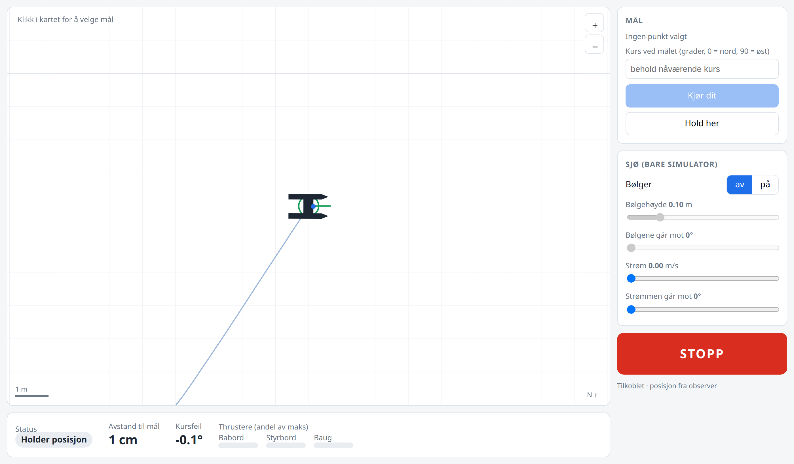
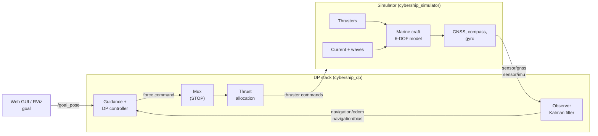

<div align="center">

# Cybership BlueBoat — Dynamic Positioning Simulator

**A ROS 2 simulator and DP control stack for the BlueBoat catamaran *Microampere*,<br>built on Fossen's marine craft models.**




<sub>The web GUI: click on the map to send the boat somewhere, switch waves and current on and off, STOP.</sub>

</div>

---

## Contents

- [What you get](#what-you-get)
- [Requirements](#requirements)
- [Quick start](#quick-start)
- [Using the simulator](#using-the-simulator)
- [How it works](#how-it-works)
- [Tests and tools](#tests-and-tools)
- [Repository layout](#repository-layout)
- [Troubleshooting](#troubleshooting)
- [Credits and license](#credits-and-license)

## What you get

| | |
|---|---|
| 🚤 **Vessel model** | 6-DOF Fossen model of Microampere: added mass and damping from Capytaine on the hull CAD, restoring forces, CG offset, nonlinear damping |
| 🌊 **Environment** | Ocean current and irregular waves (JONSWAP, short-crested) with motion RAOs |
| 📡 **Sensors** | GNSS (standard or RTK) with lever arm and slow drift, compass and gyro, at their real rates |
| 🧭 **Observer** | DP Kalman filter with wave filter and bias estimate (Fossen 13.4.6) |
| 🎯 **Control** | Model-based DP controller, guidance that picks forward, reverse or sideways moves, optional ALOS path following |
| ⚙️ **Thrusters** | Constrained allocation (QP) for two stern thrusters and a bow azimuth, T200 ESC/PWM model |
| 🖥️ **Interfaces** | RViz with the real hull mesh, and a simple web GUI in the browser |

## Requirements

| What | Version |
|---|---|
| OS | **Ubuntu 24.04** |
| ROS 2 | **Jazzy** (`ros-jazzy-desktop`) |
| Python | 3.12 (comes with Ubuntu 24.04) |
| Python packages | [`requirements.txt`](requirements.txt), installed in a venv |

Install ROS 2 Jazzy first with the [official guide](https://docs.ros.org/en/jazzy/Installation/Ubuntu-Install-Debs.html), then:

```bash
sudo apt install ros-jazzy-desktop ros-dev-tools python3-venv python3-pip \
                 ros-jazzy-topic-tools ros-jazzy-nav2-msgs ros-jazzy-xacro
```

## Quick start

**1. Clone into a ROS workspace**

```bash
mkdir -p ~/ros_ws/src && cd ~/ros_ws/src
git clone --recursive https://github.com/alihsar1kaya/cybership_blueboat.git
```

**2. Python environment**

```bash
cd ~/ros_ws
python3 -m venv venv --system-site-packages && touch venv/COLCON_IGNORE
source /opt/ros/jazzy/setup.bash && source venv/bin/activate
pip install -r src/cybership_blueboat/requirements.txt
```

**3. Build**

```bash
sudo rosdep init 2>/dev/null; rosdep update
rosdep install --from-paths src -i -y --rosdistro jazzy
colcon build --symlink-install
```

**4. Run**

```bash
source install/setup.bash
ros2 launch cybership_simulator vessel.launch.py vessel:=microampere dp:=true observer:=true gnss:=rtk
```

RViz opens with the boat. Open **http://localhost:8080** for the web GUI and click on the map to give it a goal. 🎉

> **Every new terminal** needs the three `source` lines:
> ```bash
> cd ~/ros_ws && source /opt/ros/jazzy/setup.bash && source venv/bin/activate && source install/setup.bash
> ```

## Using the simulator

### Launch options

```bash
ros2 launch cybership_simulator vessel.launch.py vessel:=microampere dp:=true [options]
```

| Option | Default | What it does |
|---|---|---|
| `dp` | `false` | Start the DP stack (controller, allocation, guidance, web GUI) |
| `observer` | `false` | Controller uses the Kalman filter estimate from simulated sensors instead of the true state |
| `gnss` | `standard` | `standard` (~0.2 m noise and slow drift) or `rtk` (~2 cm) |
| `waves` | `false` | Irregular waves from the start (can also be switched on in the GUI) |
| `wave_hs` / `wave_tp` / `wave_dir` | `0.1` / `2.3` / `0` | Wave height [m], peak period [s], direction the waves travel towards [deg] |
| `use_gui` | `true` | Start RViz |
| `web` / `web_port` | `true` / `8080` | Web GUI on/off and its port |

### Giving goals

- **Web GUI**: click on the map, type the final heading in degrees (0 = north, 90 = east), press *Kjør dit* (go).
- **RViz**: use *2D Goal Pose*.
- **Command line**:
  ```bash
  ros2 topic pub --once /goal_pose geometry_msgs/msg/PoseStamped \
    "{header: {frame_id: world}, pose: {position: {x: 5.0, y: 3.0}, orientation: {z: 0.383, w: 0.924}}}"
  ```

### Changing the sea while running

```bash
ros2 param set /microampere/sim environment.current.speed 0.15        # m/s
ros2 param set /microampere/sim environment.current.direction_deg 90  # flows towards east
ros2 param set /microampere/sim environment.waves.Hs 0.1              # m, 0 = no waves
```

> The web GUI labels are in Norwegian: *Mål* = goal, *Kjør dit* = go there, *Hold her* = hold here, *Bølger* = waves, *Strøm* = current, *STOPP* = stop (zero thrust), *FORTSETT* = resume.

## How it works

The stack follows Fossen's GNC block diagram. Each block is a ROS 2 node, so the simulator can later be swapped for the real boat's drivers without touching the rest.



All boat data (mass, hull, hydrodynamics, damping, thrusters, sensors) lives in one file:
[`cybership_config/config/microampere/vessel.yaml`](cybership_config/config/microampere/vessel.yaml). The simulator and the controller read the same file.

<details>
<summary><b>Model details</b></summary>

| Block | Implementation | Reference |
|---|---|---|
| Kinematics, rigid body, Coriolis | `cybership_utilities/marine_craft/` | Fossen (2021) ch. 2–3 |
| Added mass and damping | Capytaine radiation on the hull CAD, power-based averaging `hydro_capytaine.npz` | Fossen ch. 5–6, MSS |
| Ocean current | relative velocity, Property 10.1 | ch. 10.3 |
| Waves | JONSWAP + cos² spreading, force and motion RAOs, total = LF + WF | ch. 10.2 |
| Sensors | `marine_craft/sensors.py` | ch. 13–14 |
| Observer | `cybership_utilities/observer.py` (EKF with nonlinear damping, wave filter) | ch. 13.4.6 |
| DP control | `cybership_dp/nodes/position_control_node.py` | ch. 15 |
| Allocation | `cybership_dp/constrained_allocation.py` (QP with slack) | ch. 11.2.3 |
| Path following | `cybership_dp/los.py` (ALOS), off by default | ch. 12.5, Fossen (2023) |

</details>

## Tests and tools

```bash
# unit tests (vessel model, sensors, observer, waves, allocation, ALOS)
python3 -m pytest -q src/cybership_blueboat/cybership_utilities/test src/cybership_blueboat/cybership_dp/test
```

Headless scenario tests are in [`tools/`](tools/README.md), e.g.

```bash
GOAL="10 0 0" CURRENT="0.15 90" bash src/cybership_blueboat/tools/run_goal_motion_test.sh demo 0 observer:=true gnss:=rtk
```

Results are written to `~/ros_ws/results/`.

## Repository layout

```
cybership_config/       vessel.yaml, controller settings, Capytaine hydrodynamics and tools
cybership_simulator/    simulator node (vessel.py) and vessel.launch.py
cybership_dp/           DP controller, guidance, ALOS, allocation, observer node
cybership_utilities/    Fossen model, sensors, waves, Kalman filter, web GUI
cybership_description/  URDF and hull meshes for RViz
cybership_viz/          RViz configs
tools/                  scenario tests and plots
docs/                   original Cybership suite README and manual
```

The other packages (`cybership_bringup`, `cybership_mocap`, `cybership_thrusters`, ...) come from the original Cybership suite and are used for the lab vessels.

## Troubleshooting

<details>
<summary><b>The web GUI does not open / "address already in use"</b></summary>

Another simulator is still running. Stop it with `Ctrl+C`, or start on another port: `web_port:=8081`.
</details>

<details>
<summary><b>Nothing happens in RViz, or two terminals do not see each other</b></summary>

Both terminals must use the same `ROS_DOMAIN_ID` (check with `echo $ROS_DOMAIN_ID`) and must have sourced the workspace.
</details>

<details>
<summary><b>The build fails in a hardware package</b></summary>

Only the simulator packages are needed:

```bash
colcon build --symlink-install --packages-up-to cybership_simulator cybership_dp cybership_viz
```
</details>

<details>
<summary><b>NumPy errors after pip install</b></summary>

ROS 2 Jazzy needs NumPy 1.x: `pip install "numpy<2"`.
</details>

## Credits and license

- Built on the [**Cybership Software Suite**](https://github.com/NTNU-MCS/cybership_software_suite) by NTNU-MCS ([DOI 10.5281/zenodo.17233653](https://doi.org/10.5281/zenodo.17233653)). Its original README is in [`docs/README_cybership.md`](docs/README_cybership.md).
- Models follow T. I. Fossen, *Handbook of Marine Craft Hydrodynamics and Motion Control* (2nd ed., Wiley 2021), and the [MSS toolbox](https://github.com/cybergalactic/MSS).
- Hull geometry: [Blue Robotics BlueBoat](https://bluerobotics.com/store/boat/blueboat/blueboat/).
- Licensed under **GPL-3.0**, see [`LICENSE.md`](LICENSE.md).
