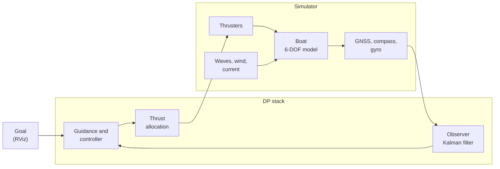

<div align="center">

# Cybership BlueBoat DP simulator

Simulator and dynamic positioning (DP) controller for *Microampere*, a BlueBoat catamaran used in my master's thesis at NTNU.


[Install](#install) · [Run](#run) · [Switches](#switches) · [Change the boat](#change-the-boat) · [How it works](#how-it-works)

</div>

---

## What it does

You give the boat a goal in RViz. It drives there and holds its position and heading while waves, wind and current push it around.

The boat model follows Fossen's marine craft equations. The added mass and damping come from running Capytaine on the hull CAD, so they are not guessed. Every number about the boat sits in one YAML file, and each part of the system (simulator, observer, controller, thrust allocation) is a separate ROS 2 node. That makes it easy to change the boat, or to swap the simulator for the real boat later.

---

## Install

You need Ubuntu 24.04 and ROS 2 Jazzy ([install guide](https://docs.ros.org/en/jazzy/Installation/Ubuntu-Install-Debs.html)).

```bash
# 1. system packages
sudo apt install ros-jazzy-desktop ros-dev-tools python3-venv python3-pip \
                 ros-jazzy-topic-tools ros-jazzy-nav2-msgs ros-jazzy-xacro

# 2. get the code
mkdir -p ~/ros_ws/src && cd ~/ros_ws/src
git clone --recursive https://github.com/alihsar1kaya/cybership_blueboat.git

# 3. Python packages
cd ~/ros_ws
python3 -m venv venv --system-site-packages && touch venv/COLCON_IGNORE
source /opt/ros/jazzy/setup.bash && source venv/bin/activate
pip install -r src/cybership_blueboat/requirements.txt

# 4. build
sudo rosdep init 2>/dev/null; rosdep update
rosdep install --from-paths src -i -y --rosdistro jazzy
colcon build --symlink-install
```

---

## Run

```bash
source install/setup.bash
ros2 launch cybership_simulator vessel.launch.py vessel:=microampere dp:=true observer:=true gnss:=rtk
```

RViz opens with the boat. Pick **2D Goal Pose** in the toolbar, then click and drag on the map to set the position and heading. The boat goes there and stays.

Every new terminal has to be sourced first:

```bash
cd ~/ros_ws && source /opt/ros/jazzy/setup.bash && source venv/bin/activate && source install/setup.bash
```

---

## Switches

### At start

Add these to the end of the `ros2 launch` line.

| Add | Effect |
|---|---|
| `dp:=true` | starts the controller. Without it the boat just floats |
| `observer:=true` | the controller gets noisy sensor data through a Kalman filter instead of the true state |
| `gnss:=rtk` | GNSS with about 2 cm error. The default receiver has about 20 cm noise and drifts slowly |
| `waves:=true` | waves, 0.05 m high by default. Change the height with `wave_hs:=0.08` |
| `wind_speed:=8 wind_dir:=90` | 8 m/s wind blowing towards east |
| `use_gui:=false` | runs without RViz, for servers and automatic tests |

### While it runs

Run these in a second terminal.

| To | Command |
|---|---|
| turn waves on or off | `ros2 param set /microampere/sim environment.waves.Hs 0.05` (0 is off) |
| turn wind on or off | `ros2 param set /microampere/sim environment.wind.speed 8` (0 is off) |
| change the wind direction | `ros2 param set /microampere/sim environment.wind.direction_deg 90` |
| turn current on or off | `ros2 param set /microampere/sim environment.current.speed 0.15` (0 is off) |
| change the current direction | `ros2 param set /microampere/sim environment.current.direction_deg 90` |
| switch the controller off or on | `ros2 service call /microampere/position_controller/change_state std_srvs/srv/SetBool "{data: false}"` (`true` turns it back on) |

Directions use the marine convention: x is north, y is east, and 90° is east. Wind, waves and current are all given as the direction they move towards, so a wind coming from the north is `wind_dir:=180`.

The BlueBoat is a 1.2 m boat built for calm water, so keep the waves between 0.02 and 0.1 m. At 0.1 m it already rolls and pitches about 1°.

<details>
<summary>Sending a goal from the terminal</summary>

```bash
# 5 m north, 3 m east, heading 45° (quaternion z = sin(45°/2), w = cos(45°/2))
ros2 topic pub --once /goal_pose geometry_msgs/msg/PoseStamped \
  "{header: {frame_id: world}, pose: {position: {x: 5.0, y: 3.0}, orientation: {z: 0.383, w: 0.924}}}"
```
</details>

---

## Change the boat

All boat data is in [`cybership_config/config/microampere/vessel.yaml`](cybership_config/config/microampere/vessel.yaml). The simulator, the controller and the observer read the same file, so you only change things in one place. Edit it and restart the launch; there is no need to rebuild.

| Section | Contents |
|---|---|
| `model` | mass, inertia, hydrodynamics, damping and the wind areas |
| `thrusters` | one entry per thruster with position, direction and strength |
| `sensors` | rate and noise for GNSS, compass and gyro |
| `allocation` | how the total force is split between the thrusters |

Each value has a comment saying where it came from. The ones marked ESTIMATE still need measuring on the real boat.

<details>
<summary>Changing a thruster</summary>

```yaml
thrusters:
  - name: port
    type: fixed                     # fixed or azimuth (rotating)
    frame: stern_port_thruster_link # link in the URDF, used by RViz
    position: [-0.55, -0.29, 0.177] # [m] x forward, y starboard, z down
    direction_deg: 0.0              # 0 pushes forward
    max_force: 67.0                 # [N]
    reverse_ratio: 0.8              # reverse thrust is 80 % of forward
```

To make it stronger, raise `max_force`. To move it, change `position`. You can delete a thruster or copy one with a new `name` and `position`; the allocation works with whatever thrusters are listed. Without the bow thruster the boat can no longer push sideways, so expect it to drift in a cross current.
</details>

<details>
<summary>Making the controller faster or calmer</summary>

The settings are in [`cybership_config/config/microampere/controller_position.yaml`](cybership_config/config/microampere/controller_position.yaml). The gains are computed from the boat model, so you mostly choose how fast it should react.

| Setting | Higher | Lower |
|---|---|---|
| `control.omega_n` | holds tighter and uses more thrust | softer |
| `filter.omega` | reaches a new goal sooner | smoother moves |
| `guidance.forward_speed` | faster transit | slower transit |

You can change them while it runs, for example `ros2 param set /microampere/position_controller guidance.forward_speed 0.4`.
</details>

<details>
<summary>Adding your own boat</summary>

1. Copy the folder: `cp -r cybership_config/config/microampere cybership_config/config/myboat`
2. Edit `myboat/vessel.yaml`. If you have no Capytaine results, delete `model.hydro` and set `added_mass` by hand.
3. Rebuild once so the new folder gets installed: `colcon build --symlink-install --packages-select cybership_config`
4. Start it with `vessel:=myboat`.

If the boat has no URDF yet it still runs, but RViz only shows the coordinate frames.
</details>

---

## How it works

The layout follows Fossen's guidance, navigation and control diagram. Each box below is its own node and they only talk through topics. To run on the real boat, you replace the simulator box with the sensor and thruster drivers and leave the rest alone.



<details>
<summary>Topics</summary>

All topics are under the vessel name, for example `/microampere/sensor/gnss`. A node that replaces a box has to publish and subscribe to the same ones.

| Topic | Type | From and to |
|---|---|---|
| `sensor/gnss` | `sensor_msgs/NavSatFix` | simulator or real GNSS to the observer |
| `sensor/imu` | `sensor_msgs/Imu` | simulator or real IMU to the observer |
| `navigation/odom` | `nav_msgs/Odometry` | observer to the controller |
| `control/force/command/position` | `geometry_msgs/Wrench` | controller to the force mux |
| `control/force/command/manual` | `geometry_msgs/Wrench` | joystick or your own node to the force mux |
| `control/force/command/mux` | `geometry_msgs/Wrench` | force mux to the allocation |
| `thruster/<name>/command` | `geometry_msgs/Wrench` | allocation to the simulator or real thrusters |
| `sim/odom_true` | `nav_msgs/Odometry` | true state from the simulator, for evaluation |

To drive manually through the mux: `ros2 service call /microampere/force_mux/select topic_tools_interfaces/srv/MuxSelect "{topic: control/force/command/manual}"`
</details>

<details>
<summary>Models and references</summary>

| Part | Code | Fossen (2021) |
|---|---|---|
| Rigid body, kinematics, Coriolis | `cybership_utilities/marine_craft/` | ch. 2–3 |
| Added mass and damping from Capytaine | `cybership_config/tools/`, `hydro_capytaine.npz` | ch. 5–6 |
| Current, wind (Blendermann) and waves (JONSWAP) | `marine_craft/environment.py`, `waves.py` | ch. 10 |
| Sensors | `marine_craft/sensors.py` | ch. 13–14 |
| Kalman filter with wave filter | `cybership_utilities/observer.py` | ch. 13.4.6 |
| DP controller and guidance | `cybership_dp/nodes/position_control_node.py` | ch. 15 |
| Thrust allocation (QP) | `cybership_dp/constrained_allocation.py` | ch. 11.2.3 |
| ALOS path following, off by default | `cybership_dp/los.py` | ch. 12.5 |
</details>

---

## Tests

```bash
python3 -m pytest -q src/cybership_blueboat/cybership_utilities/test src/cybership_blueboat/cybership_dp/test
```

The scripts in [`tools/`](tools/README.md) run longer scenarios without RViz, such as step responses or holding position in current, waves and wind.

---

## Troubleshooting

<details>
<summary>Nothing happens, or two terminals don't see each other</summary>

Check that both terminals ran the `source` line and use the same `ROS_DOMAIN_ID` (`echo $ROS_DOMAIN_ID`).
</details>

<details>
<summary>The build fails in a hardware package</summary>

You only need the simulator packages:
`colcon build --symlink-install --packages-up-to cybership_simulator cybership_dp cybership_viz`
</details>

<details>
<summary>NumPy errors</summary>

ROS 2 Jazzy is built against NumPy 1.x. Fix it with `pip install "numpy<2"`.
</details>

---

## Credits

This repository builds on the [Cybership Software Suite](https://github.com/NTNU-MCS/cybership_software_suite) from NTNU-MCS ([DOI](https://doi.org/10.5281/zenodo.17233653)). Their original README is in [`docs/`](docs/README_cybership.md). The models follow T. I. Fossen, *Handbook of Marine Craft Hydrodynamics and Motion Control* (2021), and the [MSS toolbox](https://github.com/cybergalactic/MSS). The hull geometry is from the [Blue Robotics BlueBoat](https://bluerobotics.com/store/boat/blueboat/blueboat/). Licensed under GPL-3.0, see [`LICENSE.md`](LICENSE.md).
