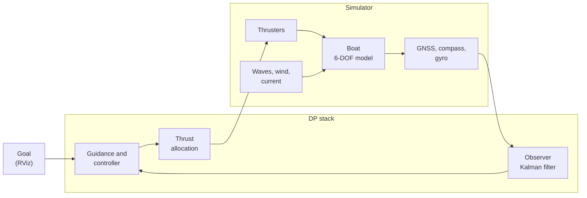

<div align="center">

# Cybership BlueBoat DP simulator

Simulator and dynamic positioning (DP) controller for *Microampere*, a BlueBoat catamaran used in my master's thesis at NTNU.


[Install](#install) · [First run](#first-run) · [Examples](#examples) · [Reference](#reference) · [Change the boat](#change-the-boat) · [How it works](#how-it-works)

</div>

---

## What it does

You give the boat a goal in RViz. It drives there and holds its position and heading while waves, wind and current push it around.

The boat model follows Fossen's marine craft equations. The added mass and damping come from running Capytaine on the hull CAD, so they are computed rather than guessed. Every number about the boat sits in one YAML file, and each part of the system (simulator, observer, controller, thrust allocation) is a separate ROS 2 node. That makes it easy to change the boat, or to swap the simulator for the real boat later.

---

## Install

You need Ubuntu 24.04 and ROS 2 Jazzy ([install guide](https://docs.ros.org/en/jazzy/Installation/Ubuntu-Install-Debs.html)). The rest takes about ten minutes.

```bash
# 1. system packages
sudo apt install ros-jazzy-desktop ros-dev-tools python3-venv python3-pip \
                 ros-jazzy-topic-tools ros-jazzy-nav2-msgs ros-jazzy-xacro

# 2. get the code
mkdir -p ~/ros_ws/src && cd ~/ros_ws/src
git clone --recursive https://github.com/alihsar1kaya/cybership_blueboat.git

# 3. Python packages, in a virtual environment that can still see ROS
cd ~/ros_ws
python3 -m venv venv --system-site-packages && touch venv/COLCON_IGNORE
source /opt/ros/jazzy/setup.bash && source venv/bin/activate
pip install -r src/cybership_blueboat/requirements.txt

# 4. build
sudo rosdep init 2>/dev/null; rosdep update
rosdep install --from-paths src -i -y --rosdistro jazzy
colcon build --symlink-install
```

Every terminal you open afterwards has to be sourced before ROS commands work:

```bash
cd ~/ros_ws && source /opt/ros/jazzy/setup.bash && source venv/bin/activate && source install/setup.bash
```

---

## First run

```bash
ros2 launch cybership_simulator vessel.launch.py vessel:=microampere dp:=true
```

RViz opens with the boat at the origin. Pick **2D Goal Pose** in the toolbar, then click on the map where the boat should go and drag in the direction it should point. The guidance plans the whole move in about a second and the boat follows the plan: it turns while it drives where there is room, turns on the spot or backs up a little where that is shorter, and arrives pointing the way you chose. Once there it stays within a centimetre or two. The section [How it works](#how-it-works) explains what happens on the way.

Stop everything with `Ctrl+C` in the launch terminal.

---

## Examples

Each example is a complete command you can paste. They all start the controller (`dp:=true`), so you can give goals in RViz as in the first run.

### 1. Calm water, perfect knowledge

```bash
ros2 launch cybership_simulator vessel.launch.py vessel:=microampere dp:=true
```

The controller is given the true position and velocity straight from the simulator. This is the best the boat can do and a good baseline when you compare other settings.

### 2. Realistic sensors

```bash
# accurate RTK GNSS (about 2 cm)
ros2 launch cybership_simulator vessel.launch.py vessel:=microampere dp:=true observer:=true gnss:=rtk

# ordinary GNSS (about 20 cm noise and a slow drift of a few decimetres)
ros2 launch cybership_simulator vessel.launch.py vessel:=microampere dp:=true observer:=true
```

With `observer:=true` the controller no longer sees the truth. It gets GNSS, compass and gyro readings at their real rates, and a Kalman filter turns them into an estimate. With RTK the boat holds 1–2 cm. With ordinary GNSS it holds 5–15 cm, but it slowly wanders with the GNSS error because it has no way of knowing the receiver is wrong. That is why the real boat should have RTK.

### 3. Waves

Pick a wave height with `wave_hs` (in metres). The BlueBoat is built for calm water, so the useful range is small:

| Sea | Command addition | What you see |
|---|---|---|
| Light ripples | `waves:=true wave_hs:=0.02` | barely moves |
| Default | `waves:=true` (0.05 m) | rolls and pitches about 0.5° |
| Choppy for this boat | `waves:=true wave_hs:=0.1` | rolls and pitches about 1°, heaves 2 cm |

For example:

```bash
ros2 launch cybership_simulator vessel.launch.py vessel:=microampere dp:=true observer:=true gnss:=rtk waves:=true wave_hs:=0.1
```

You can also change the waves while the simulator runs. Open a second terminal and turn them up, down or off:

```bash
ros2 param set /microampere/sim environment.waves.Hs 0.03            # calmer
ros2 param set /microampere/sim environment.waves.Hs 0.1             # rougher
ros2 param set /microampere/sim environment.waves.Hs 0               # off
ros2 param set /microampere/sim environment.waves.direction_deg 90   # waves now travel towards east
ros2 param set /microampere/sim environment.waves.Tp 2.0             # shorter, steeper waves
```

The boat rocks with the waves, but the controller should not try to fight that motion. The Kalman filter separates the slow drift from the fast wave motion, so the thrusters stay calm. You can see this on `sim/path_lf` in RViz, the track without the wave motion.

### 4. Wind

```bash
ros2 launch cybership_simulator vessel.launch.py vessel:=microampere dp:=true observer:=true gnss:=rtk wind_speed:=8 wind_dir:=90
```

This is an 8 m/s wind (a fresh breeze, Beaufort 5) blowing towards east, so it hits the boat from the side. The bow thruster pushes back with about 6 N and the boat still holds within a centimetre.

```bash
ros2 param set /microampere/sim environment.wind.speed 12           # stronger
ros2 param set /microampere/sim environment.wind.direction_deg 180  # now blowing towards south
ros2 param set /microampere/sim environment.wind.sigma 0.5          # gusts on
ros2 param set /microampere/sim environment.wind.mu 0.1             # how quickly gusts die out [1/s]
```

### 5. Current

```bash
ros2 launch cybership_simulator vessel.launch.py vessel:=microampere dp:=true observer:=true gnss:=rtk
# then, in a second terminal:
ros2 param set /microampere/sim environment.current.speed 0.15
ros2 param set /microampere/sim environment.current.direction_deg 90
```

Current is the hardest load for this boat. Sideways it can only push back with the bow thruster, and a side current above roughly 0.25 m/s is more than that thruster can hold. Head-on the stern thrusters take it easily, so if the current gets strong, give the boat a goal heading that points the bow into it.

### 6. Everything at once

```bash
ros2 launch cybership_simulator vessel.launch.py vessel:=microampere dp:=true observer:=true gnss:=rtk \
    waves:=true wave_hs:=0.05 wave_dir:=45 wind_speed:=6 wind_dir:=90
ros2 param set /microampere/sim environment.current.speed 0.1      # in a second terminal
```

### 7. Without RViz

```bash
ros2 launch cybership_simulator vessel.launch.py vessel:=microampere dp:=true observer:=true gnss:=rtk use_gui:=false
```

Useful on a server or for automatic tests. Send goals from the terminal:

```bash
# 5 m north, 3 m east, heading 45° (quaternion z = sin(45°/2), w = cos(45°/2))
ros2 topic pub --once /goal_pose geometry_msgs/msg/PoseStamped \
  "{header: {frame_id: world}, pose: {position: {x: 5.0, y: 3.0}, orientation: {z: 0.383, w: 0.924}}}"
```

The scripts in [`tools/`](tools/README.md) do this for you and log the result. This one moves the boat 10 m north in a side current and prints the path length and how well it held position afterwards:

```bash
GOAL="10 0 0" CURRENT="0.15 90" bash src/cybership_blueboat/tools/run_goal_motion_test.sh demo 0 observer:=true gnss:=rtk
```

### 8. Sensor delays and GNSS problems

The simulator delays the sensors and the thruster commands the way real hardware does: GNSS arrives about 0.1 s after the measurement, and a thruster reacts about 0.05 s after the command. The values are under `latency` in `vessel.yaml`. The Kalman filter knows when each GNSS fix was taken and corrects for the delay.

You can also take the GNSS away while the boat holds position:

```bash
ros2 launch cybership_simulator vessel.launch.py vessel:=microampere dp:=true observer:=true gnss:=rtk
# in a second terminal:
ros2 param set /microampere/sim sensors.gnss.available false   # GNSS gone
ros2 param set /microampere/sim sensors.gnss.available true    # back
ros2 param set /microampere/sim sensors.gnss.rtk_fix false     # RTK fix lost, accuracy drops to ~20-50 cm
ros2 param set /microampere/sim sensors.gnss.rtk_fix true      # fix back
ros2 param set /microampere/sim sensors.gnss.outage_rate 1     # random outages, about one per minute
```

Without GNSS the filter keeps going on the boat model and the compass (dead reckoning), and the observer prints a warning. In a 0.1 m/s current the boat drifted at most 8 cm during a 20 s outage, then returned once GNSS came back. Losing the RTK fix is worse: the boat follows the receiver's slow error and wanders 20–40 cm, because nothing tells it the position is wrong.

### 9. Battery voltage and thrust at speed

The thrusters lose force in two ways, as on the real boat. A lower battery voltage gives less thrust for the same command (the T200 gives 6.7 kgf at 20 V but 5.25 kgf at 16 V), and a propeller pushes less the faster water flows into it, so the thrust falls as the boat picks up speed.

```bash
ros2 launch cybership_simulator vessel.launch.py vessel:=microampere dp:=true observer:=true gnss:=rtk
# in a second terminal:
ros2 param set /microampere/sim battery.voltage 14.8                 # a 4S battery, about 70 % of full thrust
ros2 param set /microampere/sim environment.current.speed 0.2
ros2 param set /microampere/sim environment.current.direction_deg 90
```

The controller is not told about the voltage, so it has to make up for the weaker thrusters through its bias estimate. At 14.8 V in a 0.2 m/s side current the boat held within 6 cm, against 2 cm at full voltage, with the bow thruster close to its limit.

### Switching the controller off and on

```bash
ros2 service call /microampere/position_controller/change_state std_srvs/srv/SetBool "{data: false}"   # thrusters to zero
ros2 service call /microampere/position_controller/change_state std_srvs/srv/SetBool "{data: true}"    # back on
```

---

## Reference

### Launch arguments

Add them to the end of the `ros2 launch` line as `name:=value`. They are read once at start.

| Argument | Default | Unit | Meaning |
|---|---|---|---|
| `vessel` | `voyager` | | which boat; loads `cybership_config/config/<vessel>/vessel.yaml` |
| `dp` | `false` | | start the controller, guidance and thrust allocation |
| `observer` | `false` | | feed the controller from simulated sensors and a Kalman filter instead of the true state |
| `gnss` | `standard` | | `standard` or `rtk`; both profiles are defined in `vessel.yaml` |
| `noisy_odom` | `false` | | without the observer: give the controller the true state plus white noise |
| `waves` | `false` | | start with waves |
| `wave_hs` | `0.05` | m | significant wave height; keep it below about 0.15 m for this boat |
| `wave_tp` | `2.3` | s | peak period; 1.5–3 s fits short, wind-driven waves |
| `wave_dir` | `0` | deg | direction the waves travel towards |
| `wind_speed` | `0` | m/s | mean wind speed |
| `wind_dir` | `0` | deg | direction the wind blows towards |
| `use_gui` | `true` | | start RViz |
| `gazebo` | `false` | | also show the boat in a Gazebo world (needs `ros_gz`; our model stays the physics, Gazebo only draws it) |
| `gz_world` | `small_harbour` | | `small_harbour` (light, with a dock) or a VRX world such as `sydney_regatta` |

### Weather and sensors while running

Change these with `ros2 param set /microampere/sim <name> <value>`. They take effect at once.

| Parameter | Default | Unit | Meaning |
|---|---|---|---|
| `environment.waves.Hs` | from `wave_hs` | m | wave height, 0 turns the waves off |
| `environment.waves.Tp` | from `wave_tp` | s | peak period |
| `environment.waves.direction_deg` | from `wave_dir` | deg | travel direction |
| `environment.waves.spreading` | `1` | | 1 for short-crested (realistic) waves, 0 for long, parallel crests |
| `environment.wind.speed` | from `wind_speed` | m/s | mean wind speed, 0 turns the wind off |
| `environment.wind.direction_deg` | from `wind_dir` | deg | direction the wind blows towards |
| `environment.wind.sigma` | `0` | m/s/√s | gust strength, 0 for steady wind |
| `environment.wind.mu` | `0` | 1/s | how fast gusts return to the mean |
| `environment.current.speed` | `0` | m/s | current speed, 0 turns it off |
| `environment.current.direction_deg` | `0` | deg | direction the current flows towards |
| `battery.voltage` | `20` | V | battery voltage; lower gives less thrust (T200 thrust-voltage curve) |
| `sensors.gnss.available` | `true` | | false simulates a GNSS outage |
| `sensors.gnss.rtk_fix` | `true` | | false makes an RTK receiver fall back to normal accuracy (only with `gnss:=rtk`) |
| `sensors.gnss.outage_rate` | `0` | 1/min | random outages per minute, 0 for none |
| `sensors.gnss.outage_duration` | `10` | s | length of each random outage |

Directions use the marine convention: x is north, y is east, and 90° is east. Wind, waves and current are all given as the direction they move towards, so a wind coming from the north is `wind_dir:=180`.

---

## Change the boat

All boat data is in [`cybership_config/config/microampere/vessel.yaml`](cybership_config/config/microampere/vessel.yaml). The simulator, the controller and the observer read the same file, so you only change things in one place. Edit it and restart the launch; you don't need to rebuild.

| Section | Contents |
|---|---|
| `model` | mass, inertia, hydrodynamics, damping and the wind areas |
| `thrusters` | one entry per thruster with position, direction and strength |
| `sensors` | rate and noise for GNSS, compass and gyro |
| `thruster_model` | battery voltage, thrust-voltage curve and how fast thrust drops with speed |
| `latency` | delays of GNSS, IMU and thruster commands, in seconds |
| `allocation` | how the total force is split between the thrusters, when the azimuth is allowed to turn (`angle_threshold`) and whether the thrust lost at speed is compensated (`inflow_compensation`) |

Each value has a comment saying where it came from. The ones marked ESTIMATE still need measuring on the real boat; [`tools/identification.md`](tools/identification.md) describes the tests and `tools/identify.py` turns the logs into values for this file.

<details>
<summary>Changing a thruster</summary>

```yaml
thrusters:
  - name: port
    type: fixed                     # fixed or azimuth (rotating)
    frame: stern_port_thruster_link # link in the URDF, used by RViz
    position: [-0.55, -0.29, 0.177] # [m] x forward, y starboard, z down
    direction_deg: 0.0              # 0 pushes forward
    max_force: 67.0                 # [N]
    reverse_ratio: 0.8              # reverse thrust is 80 % of forward
```

To make it stronger, raise `max_force`. To move it, change `position`. You can delete a thruster or copy one with a new `name` and `position`; the allocation works with whatever thrusters are listed. Without the bow thruster the boat can no longer push sideways, so expect it to drift in a cross current.
</details>

<details>
<summary>Making the controller faster or calmer</summary>

The settings are in [`cybership_config/config/microampere/controller_position.yaml`](cybership_config/config/microampere/controller_position.yaml). The gains are computed from the boat model, so you mostly choose how fast it should react.

| Setting | Higher | Lower |
|---|---|---|
| `control.omega_n` | holds tighter and uses more thrust | softer |
| `filter.omega` | reaches a new goal sooner | smoother moves |
| `guidance.ocp.w_v` | less sideways motion | more crabbing with the bow thruster |
| `guidance.ocp.w_r` | gentler turning, more arcs | quicker turns, more turning on the spot |
| `guidance.ocp.w_rev` | backs up less | backs up more often |
| `guidance.ocp.w_f`, `w_df` | calmer, slower moves | quicker moves with more thrust |
| `guidance.forward_speed` | faster transit | slower transit |
| `guidance.sway_speed` | faster sideways moves, until the bow thruster saturates (0.2 m/s takes about 45 of its 67 N) | gentler on the bow thruster |
| `guidance.max_turn_rate_deg_s` | quicker turns; above about 30 °/s the stern thrusters saturate and the boat slides off the spot | slower turns |
| `guidance.max_dp_distance` | longer moves are done without turning first | the boat turns and drives more often |
| `guidance.dubins_radius` | wider, gentler curves | tighter turns; 0 switches the curves off (turn on the spot, drive straight, turn again) |

The `guidance.ocp` weights shape the planned moves (everything up to 25 m). The Dubins settings below them only matter for longer moves. You can change them while it runs, for example `ros2 param set /microampere/position_controller guidance.ocp.w_rev 15.0`.
</details>

<details>
<summary>Adding your own boat</summary>

1. Copy the folder: `cp -r cybership_config/config/microampere cybership_config/config/myboat`
2. Edit `myboat/vessel.yaml`. If you have no Capytaine results, delete `model.hydro` and set `added_mass` by hand.
3. Rebuild once so the new folder gets installed: `colcon build --symlink-install --packages-select cybership_config`
4. Start it with `vessel:=myboat`.

If the boat has no URDF yet it still runs, but RViz only shows the coordinate frames.
</details>

---

## How it works

The layout follows Fossen's guidance, navigation and control diagram. Each box below is its own node and they only talk through topics. To run on the real boat, you replace the simulator box with the sensor and thruster drivers and leave the rest alone.



### The ideas in short

The simulator moves the boat with Fossen's 6-DOF equations of motion, M ν̇ + C(ν)ν + D(ν)ν + g(η) = τ + τ_env. M holds the mass plus the added mass (the water the hull has to push along), D the damping and g the restoring forces from buoyancy. The added mass, damping and restoring terms come from Capytaine, a panel code run on the CAD hull, so they follow the BlueBoat's real shape rather than a box. Wind, waves and current add their own forces, and each thruster loses some thrust as the boat speeds up.

The DP stack never sees that true state. It gets GNSS positions at 5 Hz, a compass and a gyro, all with noise and delays, and a Kalman filter turns them into an estimate using a simpler 3-DOF version of the same model. Between GNSS fixes the filter predicts where the boat should be from the forces it is pushing with, and each fix corrects the guess. Besides position, heading and velocity it estimates the current and a slowly varying bias force. The bias collects whatever the model gets wrong, such as wind or a damping value that is off, and the controller cancels it.

When you give a goal, the guidance plans the whole move at once. Microampere has three thrusters, one of them a rotating bow azimuth, so it can push forwards, push sideways and turn independently. Fossen calls this fully actuated, and for such a boat at low speed the textbook answer is trajectory tracking: plan where the boat should be at every moment, then make it follow. The planner solves an optimal control problem with CasADi and IPOPT. It looks for the thrust from each thruster, second by second, that brings the boat from where it is to the goal pose at rest without exceeding the thrust and speed limits, at the lowest cost. The cost adds up time, sideways speed, yaw rate, backing up and thrust, each with a weight. Raise a weight and the boat does less of that; whether to turn while driving, turn on the spot or back up falls out of the optimization instead of a set of rules. NTNU's autonomous ferry milliAmpere plans its moves the same way. Moves longer than 25 m use a Dubins path followed with adaptive line-of-sight (ALOS) guidance instead, which suits long transits at speed.

The controller then follows the plan. It works out the force the model says is needed to move along it (mass times acceleration plus damping), adds a correction in proportion to the position and velocity error, and subtracts the bias from the Kalman filter. The gains come from pole placement on the model, so the main tuning knob is how fast it should react (`control.omega_n`).

Last, the thrust allocation splits the requested forces and turning moment between the three thrusters. It solves a small quadratic program that respects each thruster's limit and the slow rotation of the azimuth. When the request is more than the thrusters can give, it keeps the heading and gives up some surge and sway first.

<details>
<summary>Topics</summary>

All topics are under the vessel name, for example `/microampere/sensor/gnss`. A node that replaces a box has to publish and subscribe to the same ones.

| Topic | Type | From and to |
|---|---|---|
| `sensor/gnss` | `sensor_msgs/NavSatFix` | simulator or real GNSS to the observer (5 Hz) |
| `sensor/imu` | `sensor_msgs/Imu` | simulator or real IMU to the observer (50 Hz) |
| `navigation/odom` | `nav_msgs/Odometry` | observer to the controller and the allocation |
| `navigation/current` | `geometry_msgs/Vector3Stamped` | observer's estimate of the current (north, east, m/s) to the controller and the allocation |
| `control/force/command/position` | `geometry_msgs/Wrench` | controller to the force mux (body frame, N and Nm) |
| `control/force/command/manual` | `geometry_msgs/Wrench` | joystick or your own node to the force mux |
| `control/force/command/mux` | `geometry_msgs/Wrench` | force mux to the allocation |
| `thruster/<name>/command` | `geometry_msgs/Wrench` | allocation to the simulator or real thrusters |
| `control/allocation/slack` | `geometry_msgs/Wrench` | allocation to the observer: the part of the commanded force the thrusters could not give |
| `sim/odom_true` | `nav_msgs/Odometry` | true state from the simulator, for evaluation |
| `sim/path_lf` | `nav_msgs/Path` | the track without wave motion, for RViz |

To drive manually through the mux: `ros2 service call /microampere/force_mux/select topic_tools_interfaces/srv/MuxSelect "{topic: control/force/command/manual}"`
</details>

<details>
<summary>Models and references</summary>

| Part | Code | Fossen (2021) |
|---|---|---|
| Rigid body, kinematics, Coriolis | `cybership_utilities/marine_craft/` | ch. 2–3 |
| Added mass and damping from Capytaine | `cybership_config/tools/`, `hydro_capytaine.npz` | ch. 5–6 |
| Current, wind (Blendermann) and waves (JONSWAP) | `marine_craft/environment.py`, `waves.py` | ch. 10 |
| Sensors | `marine_craft/sensors.py` | ch. 13–14 |
| Kalman filter with wave filter | `cybership_utilities/observer.py` | ch. 13.4.6 |
| DP controller and guidance | `cybership_dp/nodes/position_control_node.py` | ch. 15 |
| Optimal-control trajectory planner (CasADi/IPOPT) | `cybership_dp/trajectory_planner.py` | ch. 12.1; Bitar et al. 2020 (milliAmpere) |
| Thrust allocation (QP) | `cybership_dp/constrained_allocation.py` | ch. 11.2.3 |
| Dubins paths, followed with ALOS | `cybership_dp/dubins.py`, `cybership_dp/los.py` | ch. 12.4–12.5 |
</details>

---

## Tests

```bash
python3 -m pytest -q src/cybership_blueboat/cybership_utilities/test src/cybership_blueboat/cybership_dp/test
```

The unit tests check the boat model, the weather, the sensors, the Kalman filter, the thrust allocation and the path following. They take about a minute and need no ROS nodes running.

---

## Known limitations

- Several boat values are still estimates (centre of gravity, inertia, surge time constant, thruster positions, the thrust at speed, and which voltage the 67 N thruster rating refers to). They are marked ESTIMATE in `vessel.yaml` and should be measured on the real boat.
- The slow drift force from waves (second order) is not modelled. The Kalman filter's bias estimate absorbs it, as it would on the real boat.
- The wind areas come from the CAD model. The real boat's antennas and electronics are not in it.
- There is no connection to the real boat yet. The topics are laid out for it, but the drivers still have to be written.
- Only one goal at a time; there are no waypoint routes yet.
- The planner does not know about the dock or other obstacles yet, so the boat can plan straight through them. The dock in the Gazebo world is only drawn.
- The plan is made once per goal. On the way the boat lies up to about 20 cm behind it; planning again during the move (MPC) is the next step.

---

## Troubleshooting

<details>
<summary>Nothing happens, or two terminals don't see each other</summary>

Check that both terminals ran the `source` line and use the same `ROS_DOMAIN_ID` (`echo $ROS_DOMAIN_ID`).
</details>

<details>
<summary>"Address already in use", or two boats fight each other</summary>

An older simulator is still running. Stop it with `Ctrl+C` in its terminal before starting a new one.
</details>

<details>
<summary>The build fails in a hardware package</summary>

You only need the simulator packages:
`colcon build --symlink-install --packages-up-to cybership_simulator cybership_dp cybership_viz`
</details>

<details>
<summary>NumPy errors</summary>

ROS 2 Jazzy is built against NumPy 1.x. Fix it with `pip install "numpy<2"`.
</details>

---

## Credits

This repository builds on the [Cybership Software Suite](https://github.com/NTNU-MCS/cybership_software_suite) from NTNU-MCS ([DOI](https://doi.org/10.5281/zenodo.17233653)). Their original README is in [`docs/`](docs/README_cybership.md). The models follow T. I. Fossen, *Handbook of Marine Craft Hydrodynamics and Motion Control* (2021), and the [MSS toolbox](https://github.com/cybergalactic/MSS). The hull geometry is from the [Blue Robotics BlueBoat](https://bluerobotics.com/store/boat/blueboat/blueboat/). Licensed under GPL-3.0, see [`LICENSE.md`](LICENSE.md).
